# Mindra Web

**Ruang aman untuk perasaanmu, terhubung ke yang bisa membantu.**

Ekosistem kesehatan mental digital untuk masyarakat Indonesia: aplikasi web (repositori ini) dan aplikasi mobile Flutter
(folder induk) memakai **satu backend Supabase**, sehingga catatan yang dibuat di satu tempat langsung terlihat di tempat
lain, dengan aturan izin yang sama. Dibuat untuk **UINIC 8.0 Web Development Competition 2026**, tema _Engineering
Interconnected Web Solutions to Empower Digital Ecosystems_, subtema Kesehatan (+ AI).

|                      |                                                                                                         |
| -------------------- | ------------------------------------------------------------------------------------------------------- |
| **Demo online**      | <https://web-omega-one-69.vercel.app> (Vercel, deploy otomatis dari `main`)                             |
| **Aplikasi mobile**  | Flutter, folder induk repositori ini (`../`), memakai proyek Supabase yang sama; Teman cerita lewat web |
| **Deploy**           | [`docs/DEPLOY.md`](docs/DEPLOY.md): Vercel, Supabase Auth, Upstash, SMTP, daftar periksa                |
| **Bukti pengujian**  | [`docs/TESTING.md`](docs/TESTING.md): Lighthouse, aksesibilitas, beban, tes                             |
| **Keputusan teknis** | [`docs/DECISIONS.md`](docs/DECISIONS.md) · [`docs/ARCHITECTURE.md`](docs/ARCHITECTURE.md)               |

## Masalah dan pendekatan

Menurut survei nasional I-NAMHS, 1 dari 3 remaja Indonesia mengalami masalah kesehatan mental dalam setahun, tetapi hanya
sekitar 2,6% dari mereka yang mengakses layanan bantuan ([ringkasan hasil, UGM](https://ugm.ac.id/en/news/23169-burden-of-adolescent-mental-disorders-in-indonesia-results-from-indonesia-s-first-national-mental-health-survey/)).
Jarak antara "aku merasa tidak baik" dan "aku bertemu orang yang tepat" terlalu jauh.

Mindra memendekkan jarak itu dalam tiga langkah, dan yang memegang kuncinya selalu pengguna:

1. **Mengenali**: skrining singkat dan jurnal mood serta tidur harian, dengan skor yang dihitung di server.
2. **Terhubung**: pengguna memilih psikolog dan pendamping, lalu mengatur sendiri apa yang boleh mereka lihat. Setiap
   pembukaan data tercatat dan bisa dibaca pengguna. Bila ada tanda bahaya, psikolog yang berizin melihatnya langsung.
3. **Menghubungkan sistem**: layanan kesehatan hanya menerima angka gabungan anonim, dan hasil skrining bisa diekspor dalam
   standar **FHIR R4** lewat API terbuka (dengan jalur ke SATUSEHAT atas persetujuan pengguna).

## Fitur

| Untuk                 | Fitur                                                                                                                                                                                                                                                                                                                                                                                                                                                                                                                                                         |
| --------------------- | ------------------------------------------------------------------------------------------------------------------------------------------------------------------------------------------------------------------------------------------------------------------------------------------------------------------------------------------------------------------------------------------------------------------------------------------------------------------------------------------------------------------------------------------------------------- |
| **Pengguna**          | Skrining PHQ-9, GAD-7, PSS-10, SRQ-20 (hasil identik dengan aplikasi mobile) · jurnal mood dan tidur · ringkasan mingguan · **Teman cerita** (obrolan AI) · **Konsultasi** (pilih psikolog, pilih jam, pesan) · **Privasi** (izin, riwayat akses, persetujuan SATUSEHAT) · **Bantuan** (kontak krisis, napas terpandu, grounding; terbuka tanpa masuk) · **Layanan terdekat** (jarak dihitung di perangkat) · **Panduan awal** di Beranda · **Profil** (nama, kota, ikut statistik wilayah anonim secara opt-in, ukuran teks, **unduh data**, **hapus akun**) |
| **Psikolog**          | Dasbor klien · **peringatan krisis langsung** (Realtime, tanpa muat ulang) · detail klien sesuai izin · catatan sesi · jadwal · verifikasi dua langkah (MFA) wajib                                                                                                                                                                                                                                                                                                                                                                                            |
| **Pendamping**        | Menerima undangan dengan kode · melihat hanya yang diizinkan (bawaan: mood harian dan peringatan darurat)                                                                                                                                                                                                                                                                                                                                                                                                                                                     |
| **Layanan kesehatan** | Dasbor wilayah anonim (k ≥ 10, hanya pengguna yang setuju) · peta sebaran · laporan bulanan (CSV) · pengelolaan kunci API · MFA wajib                                                                                                                                                                                                                                                                                                                                                                                                                         |
| **Admin Mindra**      | Meninjau permohonan akun psikolog (setujui dengan data direktori dan jadwal, atau tolak) · MFA wajib di database · setiap keputusan tercatat                                                                                                                                                                                                                                                                                                                                                                                                                  |
| **Pengembang**        | API publik `/api/v1` + dokumentasi interaktif `/developers` + spesifikasi OpenAPI 3.1 · FHIR R4 Observation                                                                                                                                                                                                                                                                                                                                                                                                                                                   |

Landing, **tentang**, **bantuan**, **layanan terdekat**, **syarat penggunaan**, dan **kebijakan privasi** terbuka untuk umum. Pendaftaran meminta pernyataan berusia 17 tahun ke atas dan persetujuan atas keduanya. Seluruh teks dalam Bahasa Indonesia, menyapa "kamu",
tanpa tanda seru dan emoji, dan menghindari istilah klinis di sisi pengguna.

Hasil skrining selalu disertai catatan bahwa ini skrining, bukan diagnosis. Nomor bantuan krisis berasal dari satu sumber
(`lib/domain/crisis/resources.ts`).

## Arsitektur

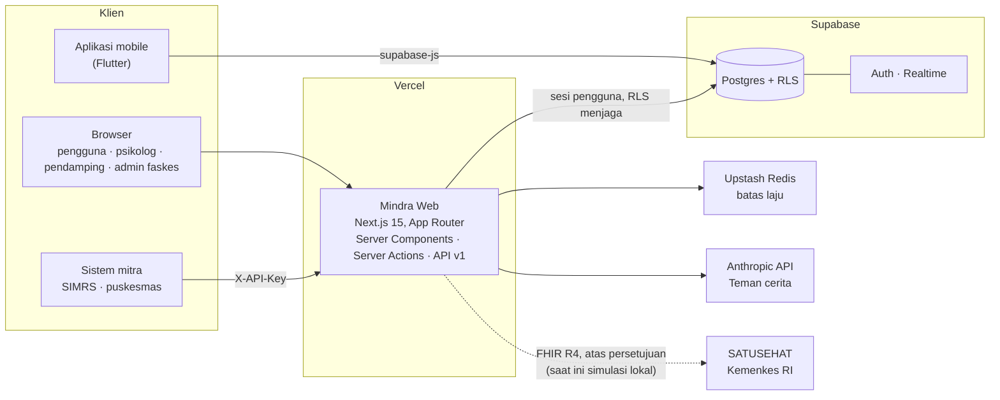

Alur peringatan krisis (dari skrining maupun Teman cerita):

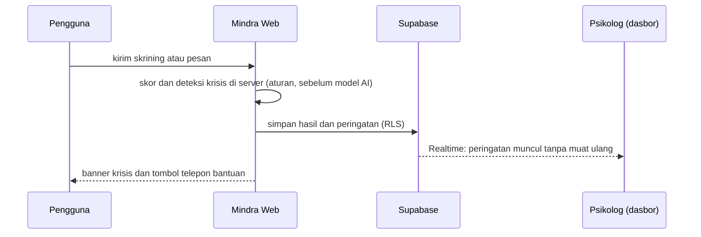

Yang membuat rancangannya bisa dipertanggungjawabkan:

- **Aturan akses ada di database, bukan hanya di tampilan.** Row Level Security di setiap tabel; fungsi `can_view()`
  menentukan siapa boleh membaca data siapa. Token yang dipakai langsung ke API pun tunduk padanya.
- **MFA ditegakkan di database** untuk psikolog dan admin faskes (klaim `aal2` di JWT), bukan sekadar mengalihkan halaman.
- **Anonimitas k ≥ 10 dihitung di database** (`facility_aggregate()`); kelompok kecil disembunyikan seluruhnya.
- **Logika skoring tunggal.** Skor skrining dihitung ulang di server dan oleh trigger database; aplikasi web dan mobile
  menghasilkan skor yang sama (dibuktikan tes yang membaca berkas Dart aslinya).
- **Deteksi krisis berbasis aturan berjalan sebelum model AI dipanggil**, dan pesan yang memuat tanda krisis dikecualikan
  dari batas 20 pesan per jam (orang yang sedang krisis tidak boleh menerima 429).

Dokumen lengkap: [`docs/ARCHITECTURE.md`](docs/ARCHITECTURE.md).

## Stack

| Lapisan   | Pilihan                                                                                                                  |
| --------- | ------------------------------------------------------------------------------------------------------------------------ |
| Aplikasi  | Next.js 15 (App Router, React Server Components, Server Actions, Route Handlers), React 19, TypeScript strict            |
| Tampilan  | Tailwind CSS v4 dengan token dari `design/tokens.css`, grafik SVG buatan sendiri, Leaflet + OpenStreetMap, ikon Phosphor |
| Backend   | Supabase: Postgres + RLS, Auth, Realtime (`@supabase/ssr`)                                                               |
| Validasi  | Zod 4 di setiap batas (formulir, Server Action, Route Handler); OpenAPI dibangkitkan dari skema yang sama                |
| AI        | Anthropic SDK, **hanya di server**                                                                                       |
| Keamanan  | Upstash Ratelimit, CSP + header keamanan, kunci API ber-hash                                                             |
| Pengujian | Vitest (unit, komponen, RLS di Postgres sungguhan via PGlite), Playwright + axe-core, Lighthouse, uji beban              |
| Deploy    | Vercel; manajer paket pnpm                                                                                               |

## Menjalankan

Prasyarat: Node.js ≥ 22.12 dan [pnpm](https://pnpm.io).

```bash
pnpm install
cp .env.example .env.local   # isi variabel Supabase; lihat docs/PANDUAN-PENGEMBANG.md
pnpm dev                     # http://localhost:3000
```

Landing, tentang, kebijakan privasi, dan dokumentasi API tampil walau `.env.local` belum diisi. Fitur berdata butuh proyek
Supabase dengan migrasi di `../supabase/migrations/` (delapan migrasi web setelah lima migrasi Flutter) dan `pnpm seed --yes` untuk
akun demo. Langkah lengkap (migrasi, MFA, variabel lingkungan, e2e dengan akun sungguhan):
[`docs/PANDUAN-PENGEMBANG.md`](docs/PANDUAN-PENGEMBANG.md).

| Perintah                  | Fungsi                                                                                        |
| ------------------------- | --------------------------------------------------------------------------------------------- |
| `pnpm lint` · `typecheck` | ESLint (aturan `jsx-a11y` diperketat) · TypeScript strict                                     |
| `pnpm test`               | Vitest, termasuk uji RLS pada Postgres (jalankan `pnpm build` dulu untuk penjaga hasil build) |
| `pnpm test:e2e`           | Playwright + axe, desktop 1440 dan mobile 390                                                 |
| `pnpm lighthouse`         | Audit Lighthouse semua halaman utama (server produksi)                                        |
| `pnpm load`               | Uji beban lokal 200 pengguna virtual                                                          |
| `pnpm usability:report`   | Rekap uji pengguna SUS dan UEQ-S dari CSV                                                     |

## Akun demo

Ada setelah `pnpm seed`. Semua berdomain `.test` (tidak bisa menerima email) dan hanya berisi data sintetis.

| Peran                                | Email                             | Masuk ke                                           |
| ------------------------------------ | --------------------------------- | -------------------------------------------------- |
| Pengguna                             | `pengguna@demo.mindra.test`       | `/beranda`                                         |
| Psikolog                             | `psikolog@demo.mindra.test`       | `/psikolog`                                        |
| Pendamping                           | `pendamping@demo.mindra.test`     | `/pendamping`                                      |
| Admin faskes                         | `faskes@demo.mindra.test`         | `/faskes`                                          |
| Admin Mindra                         | `admin@demo.mindra.test`          | `/admin`                                           |
| Calon psikolog (menunggu peninjauan) | `calon.psikolog@demo.mindra.test` | `/beranda` (muncul di antrean `/admin/verifikasi`) |

Kata sandi: `Mindra-Demo-2026`. Akun psikolog, admin faskes, dan admin Mindra wajib TOTP; untuk demo tanpa aplikasi autentikator ada dua
sakelar yang **harus keduanya** dimatikan (dijelaskan di [panduan](docs/PANDUAN-PENGEMBANG.md#mfa-psikolog)).

Halaman berlogin juga bisa dilihat tanpa akun lewat pratinjau `/dev/*` (data contoh, komponen yang sama). Di produksi
pratinjau mati kecuali `ENABLE_DEV_PAGES=true`.

## Keamanan

| Ancaman                                   | Pertahanan                                                                                                                                  |
| ----------------------------------------- | ------------------------------------------------------------------------------------------------------------------------------------------- |
| Membaca data orang lain                   | RLS di setiap tabel + `can_view()`; peran tidak bisa diubah sendiri; uji RLS di Postgres sungguhan                                          |
| Akun psikolog, faskes, atau admin dibobol | MFA (TOTP) yang ditegakkan di database, bukan hanya di halaman                                                                              |
| Data wilayah dipakai tanpa izin           | Opt-in eksplisit (bawaan mati, dijaga trigger); hanya pengguna yang setuju dihitung, dan bisa dicabut kapan saja                            |
| Data tertinggal setelah berhenti          | Hapus akun sendiri (kata sandi diperiksa ulang) menghapus seluruh data; unduh salinan JSON sebelum itu                                      |
| Penyalahgunaan akses sah                  | Setiap pembukaan data oleh psikolog, pendamping, atau admin tercatat; pengguna bisa membaca dan mengunduhnya                                |
| Re-identifikasi dari angka gabungan       | k-anonymity ≥ 10 di database; tidak ada data individu di dasbor faskes maupun API mitra                                                     |
| Injeksi dan masukan jahat                 | Zod di semua batas; kueri terparameter; CSV dan tooltip peta memperlakukan nama kota sebagai tak tepercaya                                  |
| Penyalahgunaan API                        | Batas laju per IP, per pengguna, per kunci (terbukti di bawah beban: 60 lolos dari 600 pada satu IP); kunci API hanya disimpan sebagai hash |
| XSS dan clickjacking                      | CSP tanpa `unsafe-eval` di produksi, `frame-ancestors 'none'`, HSTS, tanpa penyisipan HTML mentah                                           |
| Kebocoran rahasia                         | Kunci service role dan kunci AI hanya di server; aturan lint membatasi pemakaian klien service role                                         |
| Data kesehatan di log                     | Tidak ada `console.log` data kesehatan; aturan lint melarangnya                                                                             |

Selain itu, pembacaan skema aplikasi Flutter menemukan **8 celah** (mis. undangan pendamping bisa diambil alih siapa pun):
7 sudah ditutup lewat migrasi additive dan teruji, 1 menunggu tindakan pemilik proyek (memutar kunci yang dibundel di aplikasi
mobile). Rinciannya: [`docs/TEMUAN-KEAMANAN.md`](docs/TEMUAN-KEAMANAN.md).

## Pengujian

| Bukti                       | Hasil                                                                                                                                  |
| --------------------------- | -------------------------------------------------------------------------------------------------------------------------------------- |
| Vitest                      | **2356 tes** lulus (domain murni, API, komponen, RLS di Postgres)                                                                      |
| Playwright + axe            | **614 lulus**, 0 gagal, 68 dilewati (butuh akun sungguhan), desktop dan mobile                                                         |
| Aksesibilitas               | **0 pelanggaran axe WCAG 2.2 AA** di 33 rute x 2 viewport; audit keyboard otomatis; Lighthouse Aksesibilitas **100** di semua halaman  |
| Lighthouse (halaman publik) | Lokal: Performa 93-100, Aksesibilitas 100, Praktik terbaik 100, SEO 100. **Di produksi (Vercel): Performa 98-100, ketiganya lain 100** |
| Uji beban lokal             | 200 pengguna virtual, 25 ribu permintaan, **0 galat, p95 10,6 ms** (satu mesin, bukan k6)                                              |
| Uji mutasi                  | Lebih dari seratus perusakan sengaja pada migrasi dan logika inti; yang lolos diperbaiki atau terbukti setara                          |

Angka dan keterbatasannya (apa yang **belum** terbukti: k6 asli, uptime, uji pengguna, alur berakun di situs live) ada di
[`docs/TESTING.md`](docs/TESTING.md). Protokol uji pengguna SUS dan UEQ-S: [`docs/UJI-PENGGUNA.md`](docs/UJI-PENGGUNA.md).

## Tangkapan layar

Halaman berlogin diambil dari rute pratinjau dengan data contoh (`scripts/capture-screenshots.mjs`).

| Landing                          | Beranda pengguna                 |
| -------------------------------- | -------------------------------- |
| 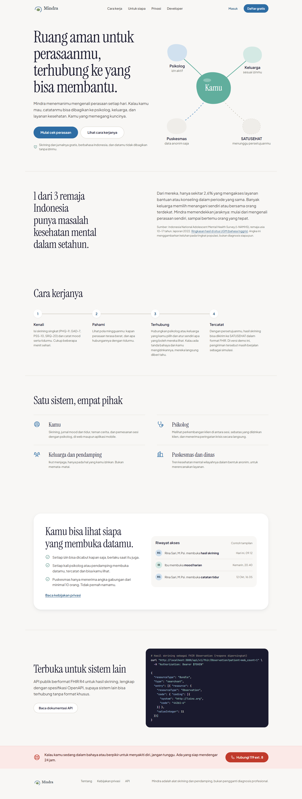 | 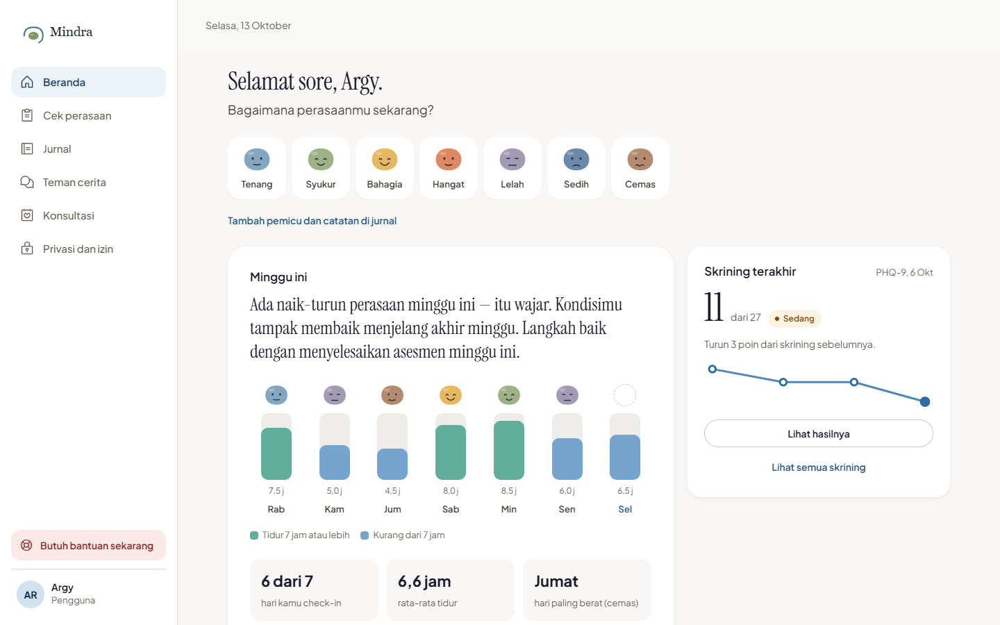 |

| Hasil skrining                                 | Teman cerita                               |
| ---------------------------------------------- | ------------------------------------------ |
| 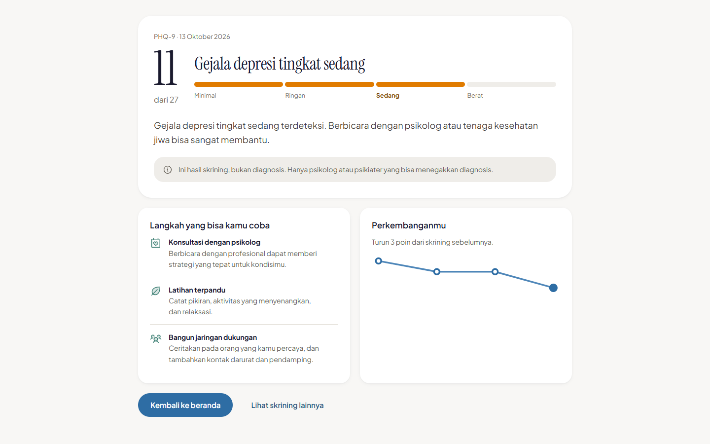 | 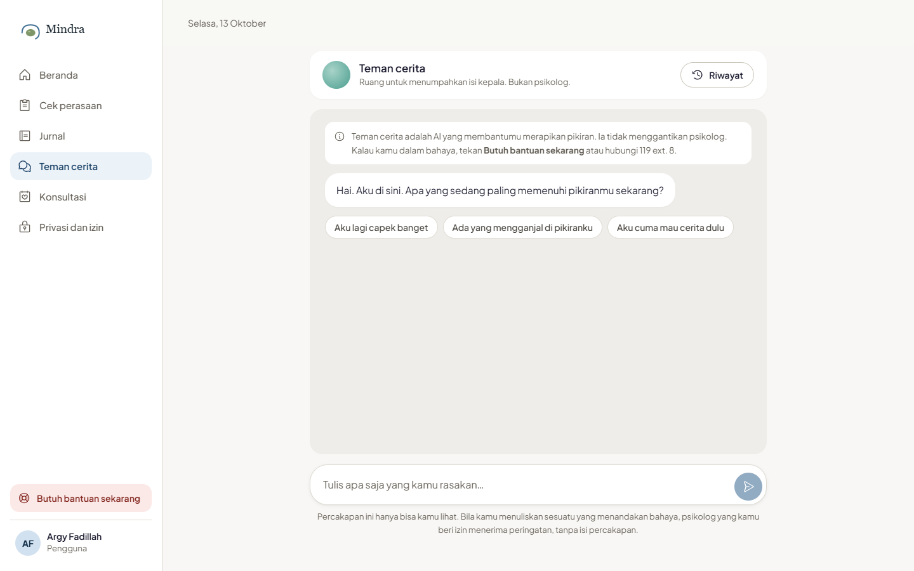 |

| Dasbor psikolog (peringatan krisis langsung)     | Privasi dan riwayat akses        |
| ------------------------------------------------ | -------------------------------- |
| 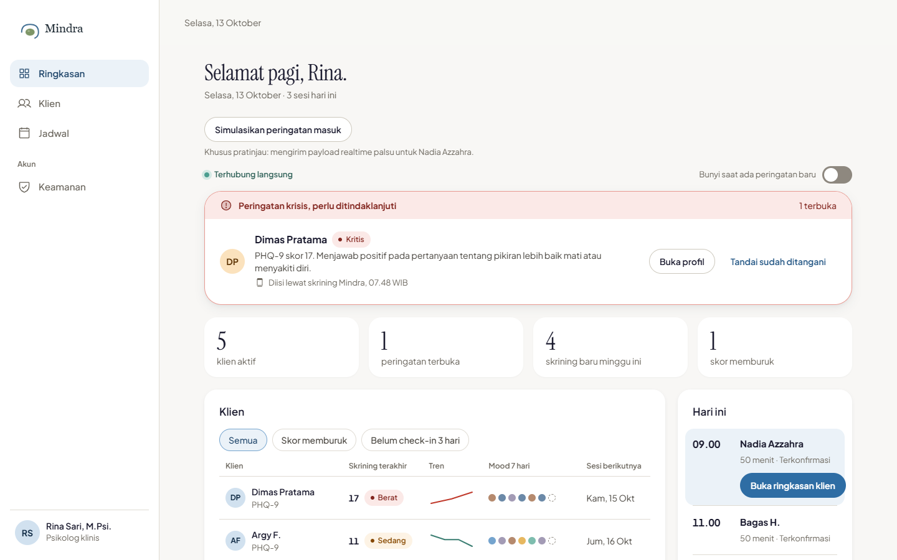 | 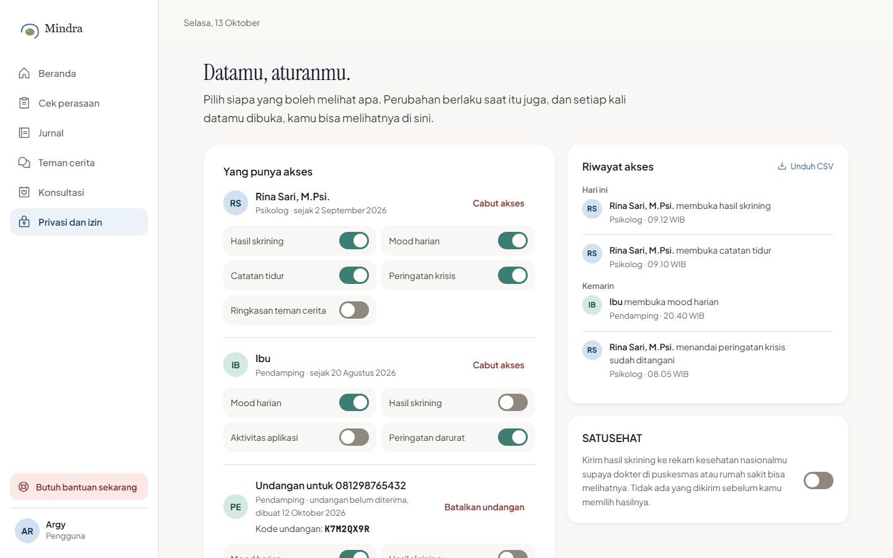 |

| Dasbor faskes (anonim)                       | Peta layanan                      |
| -------------------------------------------- | --------------------------------- |
| 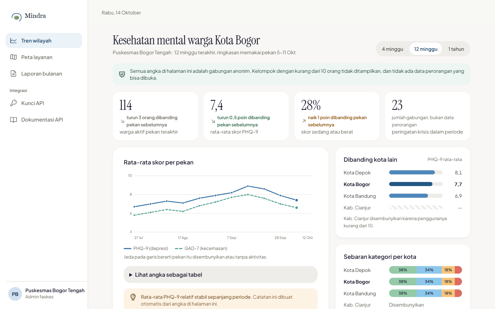 | 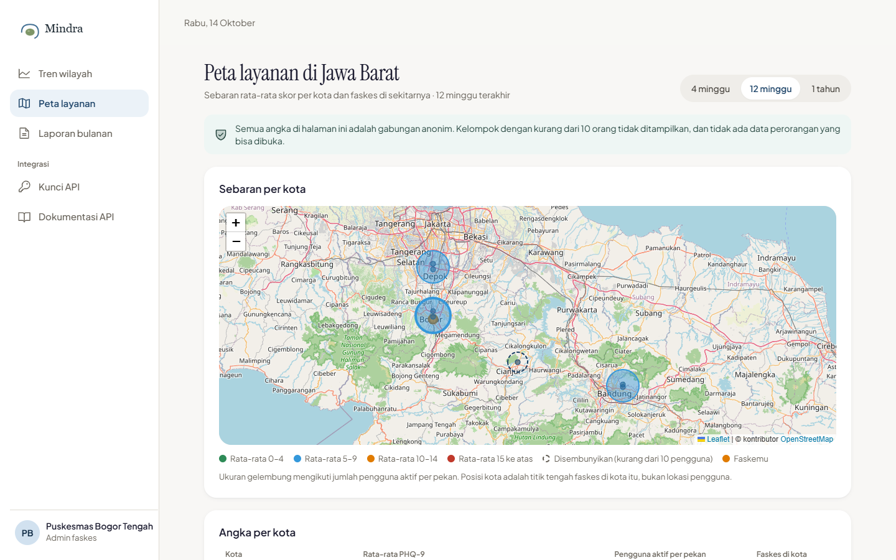 |

| Konsultasi                             | Dokumentasi API                                  |
| -------------------------------------- | ------------------------------------------------ |
| 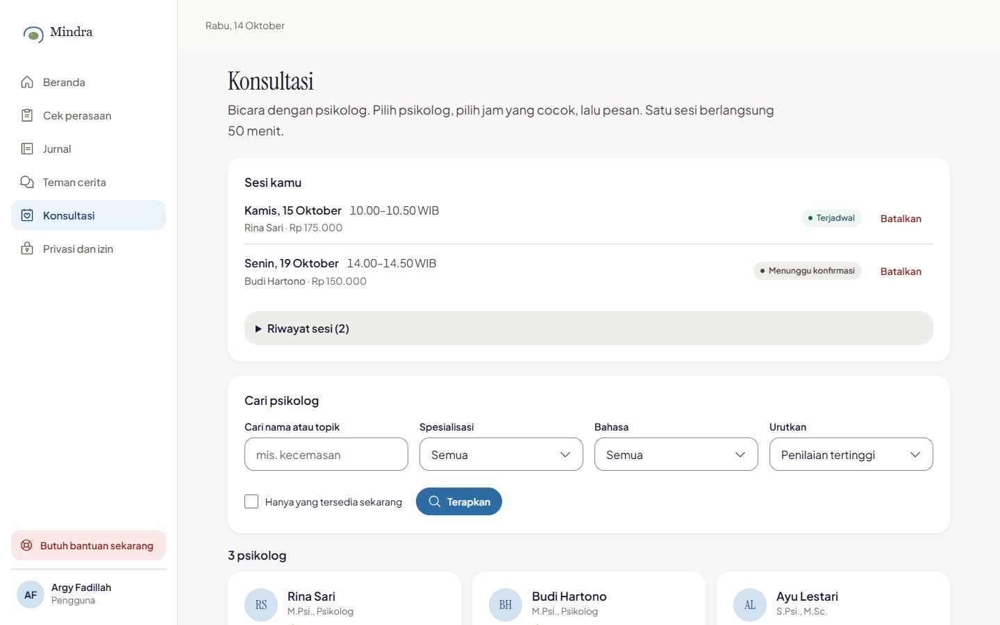 | 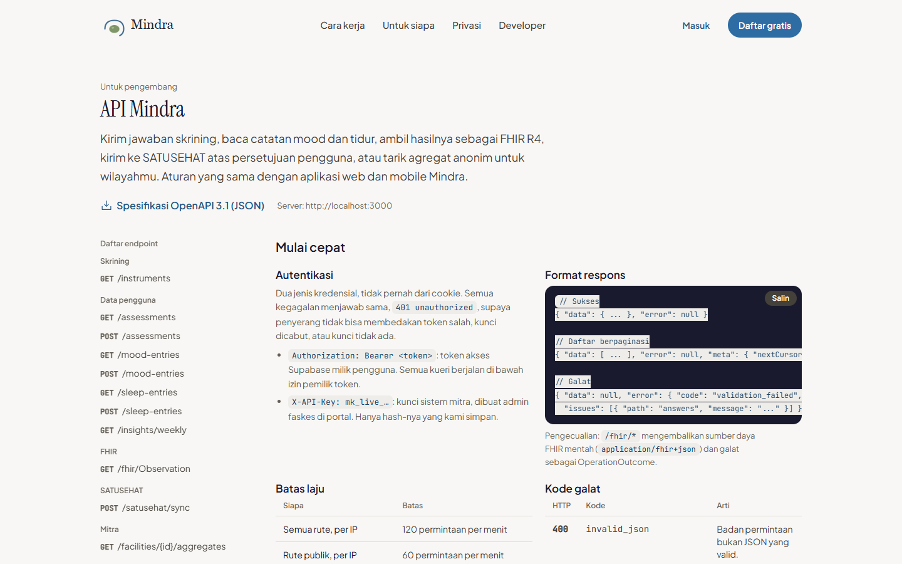 |

| Landing (mobile)                               | Beranda (mobile)                               | Teman cerita (mobile)                                    |
| ---------------------------------------------- | ---------------------------------------------- | -------------------------------------------------------- |
| 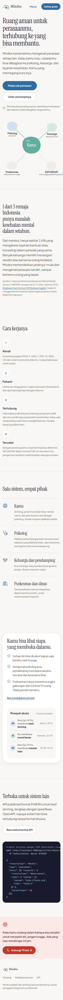 | 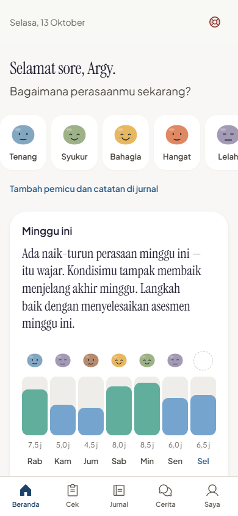 | 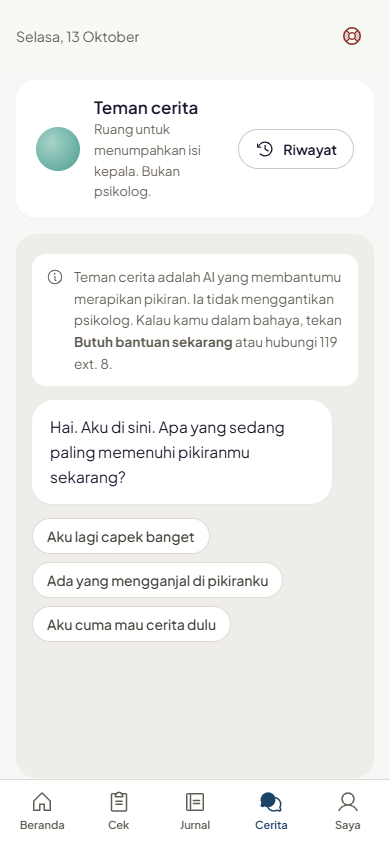 |

## Struktur

```
app/                  rute: (marketing: landing, tentang, syarat-penggunaan, kebijakan-privasi, developers) (auth) (user, termasuk profil) (psychologist) (caregiver) (facility) (admin), api/v1/*, dev/* (pratinjau)
components/           ui/ (komponen dasar) · layout/ · features/<fitur>/
lib/domain/           logika murni + tes: assessment, crisis, insight, fhir, privacy, faskes, companion, consultation, usability
lib/api/              kerangka API: defineRoute (auth, batas laju, Zod, respons), OpenAPI, rute
lib/server/           HANYA server: audit, pembacaan data berizin, klien service role (dijaga aturan lint)
lib/supabase/         klien browser/server/middleware + tipe database
load/  scripts/       uji beban (k6 dan padanan Node), seed, Lighthouse, tangkapan layar, rekap SUS
e2e/  tests/          Playwright + axe · tes RLS (PGlite), domain, komponen
design/               mockup HTML dan token desain (acuan visual)
docs/                 PLAN, ARCHITECTURE, DESIGN, DECISIONS, TEMUAN-KEAMANAN, TESTING, UJI-PENGGUNA, PANDUAN-PENGEMBANG
../supabase/migrations/   migrasi database, milik bersama web dan mobile (selalu additive)
```

## Status dan keterbatasan

Yang berjalan dan teruji ada di atas. Yang **belum**, ditulis terang:

- **Sudah dideploy dan diperiksa tanpa akun** (14-15 Okt 2026: halaman publik, `/api/health` menyentuh Supabase, guard rute,
  header keamanan, Lighthouse produksi). **Belum**: alur berakun di situs live (daftar, email, MFA, Teman cerita), uptime
  terpantau, dan k6.
- **SATUSEHAT hanya simulasi lokal.** Pemeta FHIR dan alur persetujuan teruji, tetapi belum ada kredensial staging Kemenkes;
  tidak ada data yang keluar dari server pada mode ini.
- **Teman cerita belum pernah dijalankan dengan kunci Anthropic asli.** Kodenya diuji dengan model tiruan, termasuk jalur krisis
  yang tidak memanggil model.
- **Uji pengguna (SUS dan UEQ-S) belum dilaksanakan**; alat dan protokolnya siap. **k6** belum dijalankan (ada padanan Node, lihat
  [TESTING.md](docs/TESTING.md)).
- Belum ada: CAPTCHA (Turnstile) di daftar dan masuk, verifikasi STR otomatis (admin memeriksa manual), verifikasi usia
  (hanya pernyataan sendiri), uji dengan pembaca layar sungguhan.
- Nomor bantuan krisis belum diverifikasi ke sumber resmi (`lib/domain/crisis/resources.ts`).
- Syarat penggunaan dan kebijakan privasi (versi 1.1.0, disatukan dengan naskah aplikasi mobile) belum ditinjau ahli hukum, dan
  alamat kontak pengelola data belum dicantumkan.

## Dokumentasi

- [`CLAUDE.md`](CLAUDE.md): aturan proyek · [`docs/PLAN.md`](docs/PLAN.md): urutan kerja per fase
- [`docs/ARCHITECTURE.md`](docs/ARCHITECTURE.md): data, API, keamanan · [`docs/DESIGN.md`](docs/DESIGN.md): sistem desain
- [`docs/DECISIONS.md`](docs/DECISIONS.md): keputusan dan alasannya · [`docs/TEMUAN-KEAMANAN.md`](docs/TEMUAN-KEAMANAN.md): temuan keamanan
- [`docs/TESTING.md`](docs/TESTING.md): bukti pengujian · [`docs/UJI-PENGGUNA.md`](docs/UJI-PENGGUNA.md): protokol SUS dan UEQ-S
- [`docs/PANDUAN-PENGEMBANG.md`](docs/PANDUAN-PENGEMBANG.md): menjalankan, migrasi, MFA, API, akun demo, struktur terperinci
- [`docs/HANDOFF-FASE-6.md`](docs/HANDOFF-FASE-6.md): serah terima lengkap (tujuan, fitur, arsitektur, bukti, batas) untuk penulisan proposal
- `/developers` dan `/api/v1/openapi.json`: dokumentasi dan spesifikasi API publik (saat server berjalan)
