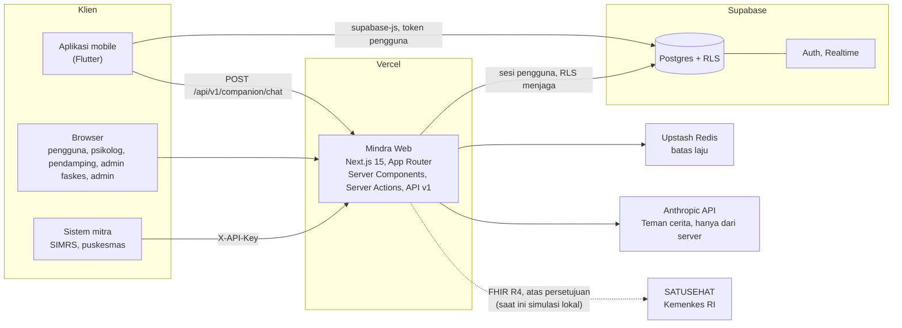
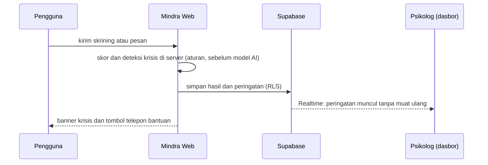

# Serah terima ke Fase 6 (proposal): Mindra

Dokumen ini ditulis oleh Claude Code (sesi pengembangan) untuk **Claude Cowork**, yang akan menulis proposal lomba
(Fase 6). Isinya sengaja lengkap dan mandiri: tujuan, fungsi, fitur aplikasi web dan aplikasi mobile, arsitektur,
keamanan, bukti pengujian, status deploy, keterbatasan, dan daftar hal yang hanya bisa dikerjakan pemilik proyek.
Disusun 14-15 Oktober 2026, setelah situs dideploy ke Vercel dan diperiksa.

| | |
| --- | --- |
| **Demo online** | <https://web-omega-one-69.vercel.app> (proyek Vercel `web`, root `web/`, deploy otomatis dari `main`) |
| **Repositori (publik)** | <https://github.com/Argy1/Mindra> (monorepo: `web/` = Next.js, akar = Flutter, `supabase/migrations/` = database bersama) |
| **Lomba** | UINIC 8.0 Web Development Competition 2026, tema _Engineering Interconnected Web Solutions to Empower Digital Ecosystems_, subtema Kesehatan (+ AI) |
| **Tenggat** | **30 Okt 2026 23.59 WIB** (batas internal 29 Okt). Penilaian juri 31 Okt-27 Nov 2026 |

## 0. Cara memakai dokumen ini

**Penanda status.** Setiap klaim di sini membawa salah satu penanda. Penulis proposal wajib mempertahankannya:

| Penanda | Arti | Boleh ditulis di proposal sebagai |
| --- | --- | --- |
| **[TERBUKTI]** | Ada tes, pengukuran, atau pemeriksaan yang bisa diulang (perintah atau berkas disebutkan) | Fakta |
| **[SIMULASI]** | Berjalan, tetapi terhadap tiruan lokal (mis. SATUSEHAT mode `mock`) | Fakta dengan keterangan "simulasi" |
| **[BELUM]** | Belum dikerjakan, belum diukur, atau menunggu pemilik | **Bukan fakta.** Tulis sebagai rencana atau proyeksi, atau jangan ditulis |
| **[PEMILIK]** | Hanya pemilik proyek yang bisa mengerjakannya (akun, rahasia, keputusan, orang) | Lihat bagian 15 |

**Aturan untuk penulis proposal**

1. Jangan menulis angka yang tidak ada di dokumen ini atau di berkas yang ditunjuknya. Bila butuh data pendukung tambahan
   (statistik nasional, rasio psikolog, dsb.), cari sendiri, beri sitasi, dan jangan mengarang.
2. Pisahkan yang **sudah terbukti** dari **proyeksi**. Bagian 11 dan 14 sudah menyiapkan pemisahnya.
3. Proposal berbahasa Indonesia **baku** ("pengguna", bukan "kamu"). Antarmuka aplikasi memakai "kamu", tanpa tanda seru
   dan emoji; itu keputusan desain, bukan gaya proposal.
4. Bila dokumen ini bertentangan dengan berkas di repositori, **berkas repositori menang**, kecuali bagian 13 (status deploy)
   yang merupakan hasil pengukuran pada 14-15 Okt 2026.
5. Sumber rinci tiap topik ada di bagian 16 (peta sumber). Alasan setiap keputusan teknis ada di `docs/DECISIONS.md`
   (dibuat untuk latihan tanya jawab babak final, yang bobotnya 40%).

## 1. Ringkasan satu halaman

**Mindra** adalah ekosistem kesehatan mental digital untuk masyarakat Indonesia. Tagline: **"Ruang aman untuk perasaanmu,
terhubung ke yang bisa membantu."** Ada dua aplikasi, **aplikasi web (Next.js)** dan **aplikasi mobile (Flutter)**, yang
memakai **satu backend Supabase**. Catatan yang dibuat di satu tempat langsung terlihat di tempat lain, dengan aturan izin
yang sama, karena aturannya hidup di database, bukan di tampilan.

Tiga langkah yang ditawarkan, dan **pengguna selalu memegang kuncinya**:

1. **Mengenali:** skrining singkat (PHQ-9, GAD-7, PSS-10, SRQ-20), jurnal mood dan tidur, ringkasan mingguan, dan
   Teman cerita (obrolan AI yang aman).
2. **Terhubung:** pengguna memilih psikolog dan pendamping, lalu mengatur sendiri apa yang boleh mereka lihat. Setiap
   pembukaan data tercatat dan bisa dibaca pengguna. Bila ada tanda bahaya, psikolog berizin melihatnya langsung (Realtime).
3. **Menghubungkan sistem:** layanan kesehatan hanya menerima **angka gabungan anonim** (k-anonymity, k >= 10, hanya
   dari pengguna yang setuju). Hasil skrining dapat diekspor sebagai **FHIR R4** lewat API terbuka, dengan jalur ke
   **SATUSEHAT** atas persetujuan pengguna (saat ini simulasi lokal).

| Ukuran | Nilai | Status |
| --- | --- | --- |
| Peran pengguna | 5: `user`, `psychologist`, `caregiver`, `facility_admin`, `admin` | [TERBUKTI] |
| Instrumen skrining | 4 (PHQ-9, GAD-7, PSS-10, SRQ-20; 46 butir), hasil identik di web, mobile, dan database | [TERBUKTI] |
| Rute API | 14 (13 di `/api/v1` + `/api/health`); OpenAPI 3.1 + dokumentasi `/developers` | [TERBUKTI] |
| Migrasi database | 13 (5 dari aplikasi mobile + 8 dari web). Additive, kecuali dua migrasi yang menghapus policy lama yang bocor atau tak berfungsi (`…000100` dan `…000400`), atas izin pemilik; tabel, kolom, dan data tidak dihapus | [TERBUKTI] |
| Tes Vitest | **2356 lulus**, 118 berkas (domain murni, API, komponen, RLS di Postgres sungguhan via PGlite) | [TERBUKTI] |
| Tes Playwright | **614 lulus**, 0 gagal, 68 dilewati (butuh akun sungguhan), desktop 1440 dan mobile 390 | [TERBUKTI] |
| Aksesibilitas (axe, WCAG 2.2 AA) | **0 pelanggaran** di 33 rute x 2 viewport | [TERBUKTI] |
| Tes Flutter | **160 lulus**; `flutter analyze` 0 galat dan 0 peringatan (115 info) | [TERBUKTI] |
| CI GitHub Actions | Hijau (web, e2e, Flutter) | [TERBUKTI] |
| Lighthouse **di produksi** (halaman publik) | Performa 98-100, Aksesibilitas **100**, Praktik terbaik **100**, SEO **100** (20 pengukuran) | [TERBUKTI] |
| Temuan keamanan pada aplikasi mobile yang sudah ada | 8 (F1-F8): 7 ditutup di kode dan teruji, 1 menunggu pemilik (cabut kunci lama) | [TERBUKTI] / [PEMILIK] |
| Ukuran kode (kira-kira) | web 34,7 ribu baris TS/TSX (termasuk tipe database hasil generate) + 27,6 ribu baris tes; Flutter 41,4 ribu baris Dart; SQL 4,2 ribu baris | [TERBUKTI] |

**Yang belum terbukti, dan tidak boleh ditulis sebagai fakta** (rincian di bagian 11 dan 14): uji pengguna (SUS dan UEQ-S) belum ada
responden; k6 asli belum dijalankan; uptime belum terpasang; Teman cerita belum pernah dicoba dengan kunci Anthropic asli
oleh saya; pengiriman ke SATUSEHAT hanya simulasi; alur berakun (daftar, masuk, email, MFA) di situs live belum saya uji;
aplikasi Flutter belum dijalankan di perangkat setelah perubahan 14 Okt; uji pembaca layar sungguhan belum ada.

## 2. Konteks lomba dan administrasi

**Kriteria juri** (urutan prioritas sesuai bobot):

| # | Kriteria | Bobot | Cara Mindra menjawabnya (bagian dokumen ini) |
| --- | --- | --- | --- |
| 1 | Inovasi dan relevansi solusi | 30% | Dua aplikasi satu backend; izin ditegakkan di database; peringatan krisis realtime; agregat anonim + FHIR (6.4, 7) |
| 2 | Kesesuaian dengan kebutuhan pengguna | 20% | Masalah I-NAMHS, kendali di pengguna, bantuan tanpa login, bahasa Indonesia hangat (3, 4, 10) |
| 3 | Kualitas teknis: validasi input, autentikasi, kode modular dan maintainable | 20% | Zod di semua batas, RLS, MFA di database, domain murni + tes, 2356 tes, audit F1-F8 (7, 9, 11) |
| 4 | UI/UX: konsistensi, usability, accessibility | 15% | Sistem desain, WCAG 2.2 AA 0 pelanggaran, Lighthouse A 100 (10). **Usability (SUS dan UEQ-S) belum terukur** |
| 5 | Dokumentasi dan kelengkapan proposal | 15% | README, ARCHITECTURE, DECISIONS, TESTING, TEMUAN-KEAMANAN, dokumen ini (16) |

Babak final: **tanya jawab bobotnya 40%**. Pemilik harus bisa menjelaskan setiap keputusan teknis; bagian 17 memuat
pertanyaan juri yang mungkin muncul beserta jawaban singkat dan rujukan.

**Format pengumpulan** (dari `docs/PLAN.md`): PDF bernama `UINIC8#2026_WEBDEV_[Nama_Tim]_[Nama Instansi].pdf`,
**maksimal 30 halaman**, Bahasa Indonesia baku, logo UINIC 8.0 di sampul; ditambah **tautan demo online** dan **tautan
GitHub publik**. Repositori harus tetap aktif sampai lomba selesai.

**Struktur wajib guidebook (a-o)**, urutan menurut `docs/PLAN.md`. Cocokkan huruf dengan buku panduan resmi bila berbeda.
Usulan anggaran halaman (jumlah maksimal 30, termasuk sampul dan daftar isi):

| Huruf | Bagian | Halaman | Bahan utama di dokumen ini |
| --- | --- | ---: | --- |
| a | Anggota tim | 0,5 | **[PEMILIK]** nama, NIM, instansi (tidak ada di repositori) |
| b | Judul | 0,5 | Usulan: lihat di bawah tabel ini |
| c | Latar belakang | 2 | Bagian 3 |
| d | Tujuan dan manfaat | 1,5 | Bagian 3 |
| e | Analisis: target pengguna, batasan produk, platform | 2,5 | Bagian 4 |
| f | Metodologi pengembangan | 1,5 | Bagian 12 (**baca catatan kejujurannya**) |
| g | Arsitektur | 4 | Bagian 7 (diagram di sana) |
| h | Skenario | 1,5 | Bagian 8 |
| i | User flow | 2,5 | Bagian 8 |
| j | Fitur unggulan | 4 | Bagian 6.4 |
| k | UI/UX preview | 3 | Bagian 10 + tangkapan layar di `web/docs/img/` |
| l | Hasil pengujian | 4 | Bagian 11 (SUS, UEQ-S, dan k6 hanya bila sudah dikerjakan) |
| m | Kesimpulan | 1 | Bagian 14 (batas dan proyeksi) |
| n | Daftar pustaka | 1 | Bagian 18 |
| o | Lampiran | 2 | Lampiran A-F |

Usulan judul (pemilik yang memutuskan): _"Mindra: Ekosistem Kesehatan Mental Digital Terhubung (Web, Mobile, dan Layanan
Kesehatan) dengan Kendali Data di Tangan Pengguna"_.

**Checklist administrasi** (semua **[PEMILIK]**, belum ada yang tercentang di repositori): daftar gelombang 2
(Rp65.000/tim) lewat Google Form + bukti follow Instagram + pindai KTM semua anggota (.pdf); konfirmasi ke narahubung
maksimal 1x24 jam setelah mendaftar dengan format `UINIC8#2026_WEBDEV_[Nama TIM]_[Nama Instansi]`; Surat Pernyataan
Orisinalitas (bermeterai Rp10.000, ditandatangani ketua); repositori publik tetap aktif; demo online dengan akun demo per
peran tercantum di proposal.

## 3. Latar belakang, masalah, tujuan, dan manfaat

### 3.1 Latar belakang dan data

Survei nasional **I-NAMHS** (Indonesia National Adolescent Mental Health Survey) menemukan bahwa sekitar **1 dari 3 remaja
Indonesia** mengalami masalah kesehatan mental dalam setahun, tetapi hanya sekitar **2,6%** dari mereka yang mengakses
layanan bantuan. Ringkasan hasil: <https://ugm.ac.id/en/news/23169-burden-of-adolescent-mental-disorders-in-indonesia-results-from-indonesia-s-first-national-mental-health-survey/>.
**[PEMILIK/penulis]** Buka sumbernya dan sesuaikan kalimat dengan angka yang tertulis di sana sebelum mencetak. Data
pendukung lain (jumlah psikolog klinis per penduduk, kebijakan kesehatan jiwa, UU Kesehatan, dsb.) **belum dikumpulkan** di
repositori; carilah dengan sitasi. Jangan menulis angka tanpa sumber.

### 3.2 Rumusan masalah: tiga jarak

1. **Jarak mengenali.** Banyak orang tidak tahu apakah yang dirasakannya perlu dibawa ke profesional. Skrining tervalidasi
   yang singkat dan jurnal harian menurunkan ambang itu.
2. **Jarak terhubung.** Antara "aku merasa tidak baik" dan "aku bertemu orang yang tepat" ada rasa malu, biaya, dan
   kekhawatiran data pribadi bocor. Pengguna butuh jalan ke psikolog dan orang tepercaya yang **mereka kendalikan sendiri**.
3. **Jarak sistem.** Data kesehatan tersekat per aplikasi dan per fasilitas; layanan kesehatan tidak punya gambaran wilayah
   yang aman secara privasi. Dibutuhkan antarmuka standar (FHIR, OpenAPI) dan agregat anonim.

### 3.3 Tujuan

- **Umum:** menyediakan ekosistem kesehatan mental digital yang aman, terhubung, dan mudah dipakai, yang memendekkan jarak
  dari mengenali kondisi sampai bertemu bantuan yang tepat.
- **Khusus:**
  1. Menyediakan skrining tervalidasi dan pelacakan mood dan tidur dengan skor yang identik di semua lapisan.
  2. Menyediakan pendamping AI (Teman cerita) dengan **jalur keselamatan yang tidak bergantung pada model AI**.
  3. Menghubungkan pengguna dengan psikolog dan pendamping lewat izin granular yang bisa dicabut dan tercatat.
  4. Memberi layanan kesehatan gambaran wilayah **anonim** tanpa membuka data individu.
  5. Membuka antarmuka standar (OpenAPI, FHIR R4) untuk integrasi mitra dan SATUSEHAT.
  6. Menjamin aksesibilitas (WCAG 2.2 AA) dan keamanan yang dapat dibuktikan lewat tes.

### 3.4 Manfaat per pemangku

| Pemangku | Manfaat |
| --- | --- |
| Pengguna (17 tahun ke atas) | Mengenali kondisi, mencatat perasaan, bercerita dengan aman, bertemu psikolog; memegang kendali penuh atas datanya (izin, riwayat akses, unduh, hapus) |
| Psikolog / konselor | Melihat klien yang memberi izin, peringatan krisis langsung, catatan sesi; akses terlindung MFA dan tercatat |
| Pendamping (keluarga, teman) | Menemani orang terdekat sesuai izin yang diberikan (bawaan: mood harian dan peringatan darurat) |
| Faskes, dinas kesehatan | Angka wilayah anonim, peta sebaran, laporan bulanan, API untuk sistem mitra |
| Pengembang mitra | API terbuka terdokumentasi, FHIR R4 Observation, kunci API ber-scope |
| Ekosistem (lomba/riset) | Contoh rancangan "privacy by design" yang diuji sampai level database, plus temuan keamanan terdokumentasi |

## 4. Analisis: target pengguna, batasan produk, platform

### 4.1 Target pengguna

| Kelompok | Siapa | Kebutuhan inti | Rute / aplikasi |
| --- | --- | --- | --- |
| Pengguna utama | Dewasa muda dan mahasiswa (pendaftaran meminta pernyataan **17 tahun ke atas**), pemakai ponsel | Mengenali, mencatat, bercerita, mencari bantuan, tanpa dihakimi | Web + aplikasi mobile |
| Psikolog / konselor | Profesional berizin (akun diverifikasi admin) | Melihat klien yang berizin, tanda bahaya cepat, jadwal | `/psikolog` |
| Pendamping | Keluarga atau teman tepercaya | Mengetahui bila orang terdekat butuh bantuan, tanpa mengintip | `/pendamping` |
| Admin faskes | Puskesmas, rumah sakit, dinas | Gambaran wilayah anonim, laporan, integrasi | `/faskes`, API |
| Admin Mindra | Pengelola produk | Meninjau permohonan akun psikolog | `/admin` |
| Pengembang mitra | Tim SIMRS, puskesmas, riset | API dan FHIR | `/developers` |

Persona ilustratif untuk proposal (**bukan hasil wawancara; beri label "ilustrasi"** bila dipakai): (a) mahasiswa yang
cemas menjelang ujian dan ragu menemui psikolog; (b) orang tua atau sahabat yang khawatir tetapi tidak ingin mengintip;
(c) psikolog kampus dengan puluhan klien yang butuh peringatan dini; (d) petugas puskesmas yang ingin tahu beban wilayah
tanpa melihat nama siapa pun.

### 4.2 Batasan produk (scope yang disengaja)

- **Bukan layanan darurat, bukan diagnosis, bukan pengganti psikolog atau psikiater.** Hasil skrining selalu disertai
  catatan itu. Dalam keadaan darurat pengguna diarahkan ke SEJIWA (119 ext. 8) dan 112.
- Hanya Indonesia dan Bahasa Indonesia; pengguna 17 tahun ke atas (pernyataan sendiri, **tidak ada verifikasi usia**).
- Statistik wilayah **opt-in** (bawaan mati). Data individu tidak pernah keluar ke faskes atau API mitra.
- Panggilan video, voice journal, dan latihan CBT lengkap ada di aplikasi mobile tetapi **tidak** di web (proyeksi).
- Pembayaran konsultasi tidak ada; web mencatat pemesanan, bukan transaksi.
- Pengiriman ke SATUSEHAT: jalur dan pemeta FHIR ada, **simulasi lokal** sampai ada kredensial staging.

### 4.3 Platform

| Lapisan | Platform |
| --- | --- |
| Web | Next.js 15 di Vercel (CDN global; halaman marketing statis), responsif (diuji 1440 px dan 390 px), peramban modern |
| Mobile | Flutter (Android dan iOS), Riverpod + go_router, `supabase_flutter` |
| Backend | Supabase (Postgres + RLS, Auth, Realtime), proyek cloud tunggal |
| Layanan pendukung | Upstash Redis (pembatas laju), Anthropic API (Teman cerita, hanya dari server), SMTP (email Auth), GitHub Actions (CI, uptime) |

## 5. Konsep solusi dan prinsip rancangan

**Satu cerita: dua aplikasi, satu backend.** Mobile dan web menulis ke tabel yang sama. Contoh: skrining diisi di ponsel
dan psikolog melihat peringatan krisisnya di web **tanpa muat ulang**, karena peringatan dibuat oleh trigger database,
bukan oleh aplikasi mana pun.

Prinsip yang mengatur semua keputusan:

1. **Kendali di tangan pengguna.** Izin granular, cabut kapan saja, riwayat "siapa membuka datamu", unduh data (JSON),
   hapus akun mandiri.
2. **Keselamatan lebih dulu daripada AI.** Deteksi krisis berbasis aturan berjalan **sebelum** model dipanggil; balasan
   krisis tetap dan tidak berasal dari model; pesan krisis tidak terkena batas laju.
3. **Aturan akses ada di database, bukan hanya di tampilan.** RLS di setiap tabel, `can_view()`, MFA (aal2) ditegakkan di
   database; token yang dipakai langsung ke API pun tunduk padanya.
4. **Anonimitas dihitung di database.** `facility_aggregate()` menyembunyikan kelompok kecil (k < 10) seluruhnya.
5. **Terbuka dan terstandar.** OpenAPI 3.1 dibangkitkan dari skema Zod yang sama dengan validasi; FHIR R4.
6. **Jujur tentang batas.** Yang simulasi ditulis simulasi; yang belum diukur ditulis belum.
7. **Hangat, bukan klinis.** Bahasa "kamu", tidak ada tanda seru dan emoji, hindari istilah klinis di sisi pengguna,
   tidak meremehkan perasaan.

## 6. Fitur

### 6.1 Aplikasi web, per peran

**Halaman publik (tanpa masuk)**

| Rute | Isi |
| --- | --- |
| `/` | Landing: masalah, tiga langkah, diagram ekosistem animasi (mati bila `prefers-reduced-motion`), akses ke bantuan |
| `/tentang` | Tentang Mindra, prinsip, batas layanan |
| `/bantuan` | **Napas terpandu**, **grounding 5-4-3-2-1**, kontak krisis (sumber tunggal `lib/domain/crisis/resources.ts`), panduan menemani orang lain. Tidak memakai cookie atau penyimpanan |
| `/layanan-terdekat` | Direktori layanan dari database; **jarak dihitung di perangkat**, lokasi pengguna tidak dikirim ke mana pun; filter provinsi dan pencarian. Menyatakan bahwa daftar ini **masih contoh** |
| `/syarat-penggunaan`, `/kebijakan-privasi` | Naskah v1.1.0 (disatukan dengan aplikasi mobile); **belum ditinjau ahli hukum** |
| `/developers`, `/api/v1/openapi.json` | Dokumentasi API interaktif (halaman server) dan spesifikasi OpenAPI 3.1 |
| `/masuk`, `/daftar`, `/lupa-sandi`, `/atur-sandi`, `/auth/callback`, `/akun-bermasalah` | Autentikasi (Supabase Auth + PKCE). Pendaftaran meminta pernyataan 17+ dan persetujuan atas syarat dan kebijakan |

**Pengguna (`user`)**

| Rute | Fungsi |
| --- | --- |
| `/beranda` | Sapaan, check-in mood cepat (7 glyph), insight mingguan, grafik mood 7 hari, grafik tidur, skrining terakhir, pintasan bantuan krisis, **panduan awal** (kartu pengenalan sekali) |
| `/asesmen`, `/asesmen/[tipe]` | Pilih instrumen; **satu pertanyaan per layar**, progres, bisa kembali, bisa diselesaikan hanya dengan keyboard; skor dihitung di server |
| `/asesmen/hasil/[id]` | Skor, kategori, penjelasan, rekomendasi, tren, catatan "ini skrining, bukan diagnosis", **banner krisis** (`role="alert"`) bila perlu |
| `/jurnal` | Check-in mood (energi, pemicu, catatan) dan pencatatan tidur |
| `/teman-cerita` | Obrolan AI streaming (SSE), disclaimer, banner krisis, riwayat percakapan, hapus percakapan |
| `/konsultasi`, `/konsultasi/[id]` | Direktori psikolog (filter), pilih slot, pesan (bentrok ditolak database), sesi saya, batalkan |
| `/privasi` | Izin per psikolog dan pendamping (cabut satu klik), **riwayat siapa membuka datamu** (unduh CSV), persetujuan SATUSEHAT, hubungkan psikolog, undang pendamping |
| `/profil` | Nama, kota, provinsi, **ikut statistik wilayah anonim (opt-in)**, ukuran teks, **unduh data** (JSON, UU PDP), **hapus akun** (kata sandi diperiksa ulang + kata penegas) |

**Psikolog (`psychologist`, MFA TOTP wajib dan ditegakkan di database)**

| Rute | Fungsi |
| --- | --- |
| `/psikolog` | Klien aktif, peringatan terbuka, jadwal hari ini, **panel peringatan krisis realtime** (tanpa muat ulang, ada tombol "tandai ditangani") |
| `/psikolog/klien`, `/psikolog/klien/[id]` | Daftar klien dengan tren; detail sesuai izin: timeline skrining, grafik mood dan tidur, catatan sesi, **ringkasan penggunaan Teman cerita** (hitungan saja, tanpa isi percakapan, hanya bila izin `ai_summary` menyala) |
| `/psikolog/jadwal` | Jadwal sesi; nama klien muncul hanya bila `care_links` aktif |
| `/psikolog/keamanan`, `/psikolog/verifikasi` | Pasang dan tantang TOTP |

**Pendamping (`caregiver`):** `/pendamping`, `/pendamping/[id]`: hanya yang diizinkan pasien (bawaan mood harian dan
peringatan darurat), panduan tanda bahaya. Undangan diterima dengan kode lewat fungsi database.

**Admin faskes (`facility_admin`, MFA wajib di database):** `/faskes` (filter periode, kartu ringkasan, tren skor
mingguan, perbandingan antar kota, distribusi kategori), `/faskes/peta` (sebaran, Leaflet + OpenStreetMap),
`/faskes/laporan` (laporan bulanan, unduh CSV), `/faskes/kunci-api` (buat, lihat prefiks, cabut), `/faskes/keamanan`,
`/faskes/verifikasi`. **Semua angka agregat k >= 10, hanya dari pengguna yang setuju.**

**Admin Mindra (`admin`, MFA wajib di database):** `/admin`, `/admin/verifikasi` (antrean pemohon akun psikolog; setujui
dengan data direktori dan jadwal, atau tolak; **atomik dalam satu transaksi database**; setiap keputusan tercatat di
`admin_actions`), `/admin/keamanan`.

**API publik `/api/v1`:** lihat Lampiran C.

### 6.2 Aplikasi mobile (Flutter, folder `lib/`)

Dibangun lebih dulu dan kini disejajarkan dengan web (perubahan 14 Okt 2026 dicatat di `CHANGELOG.md` dan
`docs/DECISIONS.md`, Gelombang 1 dan 2).

| Kelompok | Fitur |
| --- | --- |
| Skrining | PHQ-9, GAD-7, PSS-10 (butir 4, 5, 7, 8 dibalik), SRQ-20; kategori klinis, penjelasan hangat, rekomendasi, riwayat dan tren |
| Pelacakan | Mood (7 pilihan, energi, pemicu), tidur, **refleksi malam** (3 pertanyaan), **jurnal suara** terenkripsi AES-256 di perangkat |
| Latihan | CBT: catatan pikiran, aktivasi perilaku, relaksasi otot progresif, napas terpandu |
| Insight | Dasbor insight mingguan (narasi, statistik, korelasi mood dan tidur, lencana, satu rekomendasi) |
| Teman cerita | Kini memanggil web `POST /api/v1/companion/chat` dengan token sesi pengguna; **tidak ada kunci model di aplikasi** |
| Mode pendamping | Undangan dengan kode, izin granular |
| Telemedicine | Direktori psikolog, pemesanan lewat fungsi database, riwayat dan ringkasan sesi (video Agora butuh kunci yang tidak dibundel) |
| Krisis | Direktori hotline 24 jam, grounding, napas, kontak darurat |
| Peta layanan | Faskes terdekat (Google Maps butuh kunci yang tidak dibundel) |
| SATUSEHAT | Sinkronisasi hasil skrining opt-in sebagai FHIR Observation |
| Laporan | Ekspor PDF ringkasan skrining, mood, tidur |
| Aksesibilitas | Ukuran teks 4 tingkat, kontras tinggi, gaya bahasa formal atau santai, kurangi gerak |
| Notifikasi | Notifikasi lokal adaptif (check-in, refleksi malam, insight, pengingat asesmen dan konsultasi) |
| Baru 14 Okt | Pemesanan lewat `book_consultation`, edit profil (kota, provinsi, opt-in statistik), hapus akun nyata (`delete_my_account`), pendaftaran 17+ dengan persetujuan, label hotline SEJIWA diperbaiki |

Status: `flutter analyze` 0 galat dan 0 peringatan, `flutter test` **160 lulus** **[TERBUKTI]**. Aplikasi **belum
dijalankan di perangkat atau emulator setelah perubahan 14 Okt** dan Teman cerita di mobile baru bekerja setelah
`WEB_API_BASE_URL` diisi dan aplikasi dibangun ulang **[BELUM]**.

### 6.3 Paritas web dan mobile

| Kemampuan | Web | Mobile | Catatan |
| --- | :-: | :-: | --- |
| Skrining 4 instrumen | ya | ya | Hasil identik (tes membaca berkas Dart asli; trigger database menghitung ulang) |
| Mood dan tidur | ya | ya | Tabel sama |
| Teman cerita | ya | ya (lewat web) | Satu sumber kontrol di server |
| Konsultasi (pesan) | ya | ya | Fungsi database yang sama (`book_consultation`) |
| Pendamping | ya | ya | Undangan lewat RPC |
| Portal psikolog | ya | tidak | Hanya web |
| Dasbor faskes, API mitra | ya | tidak | Hanya web |
| Admin | ya | tidak | Hanya web |
| Jurnal suara, CBT lengkap, video | tidak | ya | Proyeksi untuk web |
| Profil, unduh data, hapus akun | ya | hapus akun dan profil ya; unduh data hanya web | |

### 6.4 Fitur unggulan (kandidat bab j)

| # | Fitur | Mengapa unggul | Bukti |
| --- | --- | --- | --- |
| 1 | **Dua aplikasi, satu backend, satu aturan izin** | Data dan izin konsisten di web dan mobile; peringatan krisis dari skrining mobile muncul di portal psikolog web | `can_view()`, trigger `crisis_alerts`; `tests/db/*` |
| 2 | **Peringatan krisis realtime ke psikolog** | Supabase Realtime; dibuat oleh trigger database, jadi berlaku dari klien mana pun | `tests/db/care-ecosystem.test.ts`, `e2e/fase2.spec.ts` |
| 3 | **Kendali dan transparansi data** | Izin granular, cabut satu klik, riwayat akses yang bisa diunduh, unduh data, hapus akun | `/privasi`, `/profil`; `tests/db/region-admin.test.ts` |
| 4 | **Keamanan ditegakkan di database** | RLS di setiap tabel, MFA aal2 di `can_view()`, k-anonymity di fungsi, penjaga kolom istimewa; mutasi sengaja pada migrasi tertangkap suite | DECISIONS (tiap fase), TEMUAN-KEAMANAN |
| 5 | **Keselamatan AI** | Deteksi krisis berbasis aturan sebelum model; balasan krisis tetap; pesan krisis dikecualikan dari batas 20 pesan per jam; kunci model hanya di server | `lib/server/companion.ts`; mutasi "krisis-sebelum-model" |
| 6 | **Interoperabilitas** | API publik + OpenAPI 3.1 dari skema yang sama dengan validasi; FHIR R4 Observation; jalur SATUSEHAT; agregat anonim untuk mitra | `/developers`, `lib/domain/fhir`; SATUSEHAT **simulasi** |
| 7 | **Audit keamanan aplikasi yang sudah ada** | 8 temuan (F1-F8), 7 ditutup dan diuji; menunjukkan kesadaran keamanan, bukan hanya fitur | `docs/TEMUAN-KEAMANAN.md` |
| 8 | **Aksesibilitas yang diukur dan diberi kontrol negatif** | axe WCAG 2.2 AA 0 pelanggaran di 33 rute x 2 viewport; kontrol negatif membuktikan audit bisa gagal; Lighthouse A 100 | `e2e/fase5.spec.ts`, `docs/TESTING.md` |
| 9 | **Bantuan tanpa masuk, privasi lokasi** | Napas, grounding, kontak krisis, layanan terdekat; koordinat pengguna tidak meninggalkan perangkat (e2e merekam semua permintaan) | `e2e/gelombang3.spec.ts` |
| 10 | **Statistik wilayah opt-in** | Kota adalah data pribadi; hanya yang setuju dihitung; bawaan mati; dijaga trigger | `…000600`; `tests/db/region-admin.test.ts` |

## 7. Arsitektur

### 7.1 Diagram

### 7.2 Stack

| Lapisan | Pilihan |
| --- | --- |
| Aplikasi web | Next.js 15.5 (App Router, React Server Components, Server Actions, Route Handlers), React 19, TypeScript strict |
| Tampilan | Tailwind CSS v4 dengan token dari `design/tokens.css`, grafik SVG buatan sendiri, Leaflet + OpenStreetMap, ikon Phosphor, font Plus Jakarta Sans dan Instrument Serif |
| Backend | Supabase: Postgres + RLS, Auth, Realtime (`@supabase/ssr`) |
| Validasi | Zod 4 di setiap batas (formulir, Server Action, Route Handler); OpenAPI dibangkitkan dari skema yang sama |
| AI | Anthropic SDK, **hanya di server**; model bawaan `claude-sonnet-5-5` (dapat diubah lewat `ANTHROPIC_MODEL`) |
| Keamanan | Upstash Ratelimit (cadangan memori), CSP + header keamanan, kunci API disimpan sebagai hash SHA-256 |
| Pengujian | Vitest, Playwright + axe-core, Lighthouse 12.8.2, uji beban Node (+ skrip k6), PGlite (Postgres sungguhan di memori) |
| Mobile | Flutter, Riverpod, go_router, `supabase_flutter`, fl_chart, lottie |
| Deploy | Vercel (web), Supabase cloud, GitHub Actions (CI dan uptime); manajer paket pnpm |

### 7.3 Model data

- **Tabel dari aplikasi mobile (dipakai ulang, tidak diubah strukturnya):** `profiles`, `assessments`, `mood_entries`,
  `sleep_entries`, `night_reflections`, `caregiver_relationships`, `psychologists`, `psychologist_schedules`,
  `consultations`, `consultation_messages`, `ai_conversations`, `satusehat_sync_log`, `emergency_contacts`,
  `activity_logs`, `notifications_log`, `exercise_sessions`, `thought_records`, `voice_journals`, `reflection_questions`.
- **Tabel baru dari web:** `care_links` (izin klien ke psikolog), `crisis_alerts` (Realtime), `data_access_logs` (siapa
  membuka data siapa), `facilities`, `facility_admins`, `api_clients` (kunci API ber-hash), `admin_actions`,
  `caregiver_invite_attempts`.
- **Kolom tambahan penting:** `profiles.role`, `profiles.is_demo`, `profiles.requested_role`, `profiles.satusehat_consent`,
  `profiles.share_region_stats`, `psychologists.profile_id`.
- **Fungsi database inti (semua `security definer` dengan `search_path = ''`):** `can_view(subjek, sumber)`,
  `psychologist_mfa_ok()`, `facility_aggregate()`, `book_consultation()`, `psychologist_available_slots()`,
  `psychologist_booked_slots()`, `log_access()` dan `log_access_batch()`, `my_access_log()`, `psychologist_clients()`,
  `patient_caregivers()`, `caregiver_patient_names()`, `accept_caregiver_invite()`, `decline_caregiver_invite()`,
  `delete_my_account()`, `admin_pending_psychologists()`, `admin_review_psychologist()`, `client_companion_activity()`;
  trigger integritas asesmen (`trg_assessments_enforce_integrity`), pembuat `crisis_alerts`, penjaga kolom istimewa pada
  `profiles`, penjaga konsultasi.
- Constraint `EXCLUDE USING gist` mencegah dua sesi aktif yang tumpang-tindih untuk psikolog atau pasien yang sama.
- Rincian: `docs/ARCHITECTURE.md` bagian 4; daftar migrasi di Lampiran D.

### 7.4 Keputusan arsitektur yang layak disebut di proposal

1. **RLS + `can_view()` sebagai satu-satunya aturan baca lintas pengguna.** Aturan sama untuk web, mobile, dan token API.
2. **MFA di database, bukan hanya di layar.** Token aal1 yang dipakai langsung ke PostgREST tidak membaca data klien
   (`psychologist_mfa_ok()` memeriksa klaim `aal2` di JWT). Setiap halaman portal juga memanggil gerbang MFA sebagai langkah
   pertama; layout hanya lapisan kedua.
3. **Persetujuan akun psikolog di dalam database, atomik.** Bukan service role di Next.js. Admin tidak memegang kunci sakti.
4. **Skoring tunggal.** Server Action web menghitung skor dan tidak menerima skor dari klien; trigger database menghitung ulang
   untuk semua klien (termasuk mobile). Tes membuktikan 120 kombinasi acak per instrumen identik antara web dan database.
5. **Logika domain murni di `lib/domain/**`** (tanpa I/O, masing-masing dengan tes): skoring, krisis, insight, FHIR, privasi,
   faskes, companion, konsultasi, profil, bantuan, onboarding, SUS.
6. **API:** `defineRoute` menyatukan urutan IP -> autentikasi -> batas per kredensial -> Zod -> handler -> respons
   `{ data, error, meta }`. Seluruh kueri API memakai penyaring `user_id` eksplisit (RLS saja tidak cukup).
7. **Halaman berdata per pengguna tidak diprerender** (data satu orang tidak boleh masuk cache CDN); halaman marketing statis.
   Tes penjaga hasil build memeriksanya.
8. **CSP tanpa `unsafe-eval`;** Zod berjalan `jitless` di browser agar tidak memicu pelanggaran CSP.

### 7.5 Interoperabilitas: FHIR dan SATUSEHAT

- `GET /api/v1/fhir/Observation?patient=me` mengembalikan **FHIR R4 Bundle** hasil skrining (PHQ-9 = LOINC `44261-6`, GAD-7 =
  LOINC `70274-6`; PSS-10 dan SRQ-20 memakai coding lokal). Bundel **tidak memuat jawaban per butir** (butir 9 PHQ-9 tidak
  keluar). **Kode LOINC belum diverifikasi ulang ke loinc.org dan bundel belum divalidasi dengan validator HL7 resmi** (hanya
  diperiksa strukturnya oleh tes) **[BELUM]**.
- `POST /api/v1/satusehat/sync` hanya untuk pengguna yang menyalakan persetujuan (`profiles.satusehat_consent`), tidak
  menggandakan bila diulang, dan dicatat di `satusehat_sync_log`.
- **Mode `mock` = simulasi lokal sepenuhnya:** struktur diperiksa, dijawab dengan id tiruan `mock-...`, **tidak ada byte yang
  keluar** dari server. Mode `staging` (OAuth2 client credentials, `POST /Observation`) sudah ditulis tetapi **belum
  dicoba**: butuh kredensial staging Kemenkes dan nomor IHS pasien **[BELUM] [PEMILIK]**. Tulis mode yang dipakai dengan
  jujur di proposal; saat ini **[SIMULASI]**.

### 7.6 Teman cerita (AI)

1. Pembatas laju (20 pesan per jam per pengguna; pesan krisis dikecualikan).
2. **Deteksi krisis berbasis aturan** (port dari `crisis_detector.dart`) **sebelum** model.
3. Krisis: buat `crisis_alerts` (tidak diulang selama 6 jam bila masih terbuka), kirim **balasan krisis tetap** (bukan dari
   model), tampilkan banner, tanpa memanggil model.
4. Aman: panggil model dengan perintah sistem (tanpa emoji, tanpa meremehkan), streaming SSE (`meta`, `delta`, `crisis`,
   `done`, `error`), simpan di `ai_conversations`.
5. Yang dikirim ke Anthropic hanya perintah sistem dan isi percakapan, **tanpa nama, email, atau id**. Pengguna dapat
   menghapus percakapan. Psikolog hanya bisa melihat **hitungan** penggunaan (izin `ai_summary`), tidak pernah isinya.
6. **Belum pernah dicoba dengan kunci Anthropic asli oleh saya**; kodenya diuji dengan model tiruan, termasuk jalur krisis
   **[BELUM]**.

## 8. Skenario dan user flow

Gunakan alur ini sebagai bahan bab h (skenario) dan i (user flow). Setiap alur sudah didukung kode dan tes; yang diuji
dengan akun sungguhan di situs live ditandai pada bagian 13.

**A. Pengguna baru memulai.** `/daftar` (pernyataan 17+, setuju syarat dan kebijakan) -> email konfirmasi -> `/auth/callback`
-> `/beranda` dengan panduan awal -> `/asesmen` memilih PHQ-9 -> satu pertanyaan per layar -> `/asesmen/hasil/[id]`: skor,
kategori, rekomendasi, catatan "ini skrining, bukan diagnosis".

**B. Tanda bahaya terdeteksi.** PHQ-9 butir 9 > 0 (atau SRQ-20 butir 17 = ya, atau kategori berat) -> banner krisis dengan tombol
telepon SEJIWA -> trigger database membuat `crisis_alerts` -> psikolog tertaut (sesi aal2) melihat peringatan **tanpa muat
ulang** -> menandai "ditangani". Sama bila skrining diisi dari aplikasi mobile.

**C. Bercerita ke Teman cerita.** Pesan dikirim -> batas laju -> deteksi krisis -> (krisis) balasan tetap + peringatan, atau
(aman) balasan model streaming -> percakapan tersimpan, dapat dihapus pengguna.

**D. Menemui psikolog.** `/konsultasi` -> direktori dan filter -> pilih slot (kisi jam WIB, sesi 50 menit, 1 jam sampai 30 hari
ke depan, maksimal 3 sesi mendatang) -> `book_consultation` (bentrok ditolak constraint database -> 409) -> sesi muncul di
`/konsultasi` pengguna dan `/psikolog/jadwal` psikolog.

**E. Mengatur izin dan melihat siapa membuka data.** `/privasi` -> hubungkan psikolog -> atur izin (skrining, mood, tidur,
peringatan krisis, ringkasan Teman cerita) -> psikolog membuka klien -> **tercatat** di `data_access_logs` **sebelum** data
dibaca (gagal mencatat berarti data tidak dibaca) -> pengguna melihat dan mengunduh riwayat -> mencabut izin satu klik.

**F. Mengundang pendamping.** Pengguna membuat undangan (kode dibuat server, acak) -> pendamping memasukkan kode (RPC
`accept_caregiver_invite`: kode tepat, maksimal 14 hari, bukan milik sendiri, 5 gagal per 15 menit) -> pendamping melihat
hanya yang diizinkan.

**G. Layanan kesehatan melihat gambaran wilayah.** Admin faskes masuk dengan TOTP -> `/faskes` -> angka per kota dan minggu
(**k >= 10**, hanya pengguna yang ikut) -> peta -> laporan CSV; atau sistem mitra memakai `X-API-Key` ke
`/api/v1/facilities/{id}/aggregates`.

**H. Admin meninjau permohonan psikolog.** Calon psikolog mendaftar dan meminta peran -> admin (TOTP) membuka
`/admin/verifikasi` -> setujui dengan data direktori dan jadwal (satu transaksi: peran, baris direktori, jadwal, jejak) atau
tolak -> pemohon keluar dan masuk lagi untuk berpindah ke portal psikolog. **Admin memeriksa STR secara manual; tidak ada
verifikasi otomatis.**

**I. Mencari bantuan tanpa masuk.** `/bantuan` (napas terpandu, grounding, kontak krisis) dan `/layanan-terdekat` (jarak dihitung
di perangkat, lokasi tidak dikirim).

**J. Mengambil kembali data.** `/profil` -> unduh data (JSON seluruh data, 17 bagian + riwayat akses) -> hapus akun (kata sandi
diperiksa ulang, ketik HAPUS) -> `delete_my_account()` menghapus akun dan seluruh datanya (cascade).

### Skrip demo untuk video atau juri (sekitar 7 menit)

Akun demo (Lampiran A). Urutan disarankan: (1) landing dan `/bantuan` tanpa masuk (30 dtk); (2) masuk sebagai pengguna, isi
PHQ-9 dengan butir 9 > 0, tunjukkan banner krisis (2 mnt); (3) di jendela lain masuk sebagai psikolog (TOTP), tunjukkan
peringatan muncul tanpa muat ulang dan catatan akses (2 mnt); (4) kembali ke pengguna, buka `/privasi`, tunjukkan riwayat akses
dan cabut izin (1 mnt); (5) masuk sebagai admin faskes, tunjukkan agregat anonim dan peta, sebut k >= 10 (1 mnt); (6) `/developers`
dan satu panggilan API (30 dtk). Pemasangan TOTP untuk akun psikolog, faskes, dan admin harus disiapkan sebelumnya
(DEPLOY.md bagian 8) **[PEMILIK]**.

## 9. Keamanan, privasi, dan etika

### 9.1 Ancaman dan pertahanan

| Ancaman | Pertahanan | Bukti |
| --- | --- | --- |
| Membaca data orang lain | RLS di setiap tabel + `can_view()`; peran tidak bisa diubah sendiri (trigger penjaga) | `tests/db/*` (Postgres sungguhan) |
| Akun psikolog, faskes, admin dibobol | MFA TOTP ditegakkan di database (klaim `aal2`) | `tests/db/care-ecosystem.test.ts`, `facility-booking.test.ts` |
| Data wilayah dipakai tanpa izin | Opt-in eksplisit, bawaan mati, dijaga trigger; hanya yang setuju dihitung | `tests/db/region-admin.test.ts` |
| Penyalahgunaan akses sah | Setiap pembukaan data oleh psikolog, pendamping, atau admin tercatat; pengguna bisa membaca dan mengunduhnya | `lib/server/audit.ts`, mutasi |
| Re-identifikasi dari agregat | k-anonymity >= 10 di database; tidak ada data individu di dasbor faskes maupun API mitra | `facility_aggregate()` |
| Injeksi dan masukan jahat | Zod di semua batas; kueri terparameter; CSV dan tooltip peta memperlakukan nama kota sebagai tak tepercaya | tes komponen dan e2e |
| Penyalahgunaan API | Batas laju per IP, per pengguna, per kunci (di bawah beban: 60 lolos dari 600 pada satu IP); kunci API hanya hash | `pnpm load --limiter-check` |
| XSS dan clickjacking | CSP tanpa `unsafe-eval`, `frame-ancestors 'none'`, HSTS, tanpa penyisipan HTML mentah | Header live diperiksa (bagian 13) |
| Kebocoran rahasia | Kunci service role dan kunci AI hanya di server; aturan lint membatasi; tes memeriksa bundel klien | `pnpm test` |
| Data kesehatan di log | Tidak ada `console.log` data kesehatan; aturan lint melarangnya | lint |
| Lokasi pengguna bocor | Koordinat hanya di peramban; e2e merekam semua permintaan jaringan | `e2e/gelombang3.spec.ts` |
| Psikolog membaca isi curhat | Izin `ai_summary` hanya membuka hitungan; tidak ada policy baca pada `ai_conversations` untuk psikolog | `tests/db/companion-activity.test.ts` |

Catatan jujur yang boleh dipakai sebagai nilai tambah: CSP memakai `'unsafe-inline'` untuk skrip (CSP bernonce meniadakan
halaman statis; jalur peningkatan dicatat); cookie sesi tidak `HttpOnly` (klien Realtime membaca token; mitigasi SameSite=Lax,
Secure, CSP); **CAPTCHA (Turnstile) belum dipasang** [BELUM]; kedaluwarsa otomatis kunci API belum ada.

### 9.2 Temuan keamanan pada aplikasi mobile yang sudah ada (F1-F8)

Ditemukan dengan membaca `supabase/migrations/2024*.sql` dan kode Dart. Semuanya **sudah ada sebelum web**. Setiap temuan punya
bukti yang bisa dijalankan ulang (`pnpm test tests/db`) dan perbaikannya diuji dengan **uji mutasi**.

| # | Temuan | Tingkat | Status |
| --- | --- | --- | --- |
| F1 | Undangan pendamping bisa dibaca dan diambil alih siapa pun | Tinggi | Ditutup (migrasi `…000100` + Flutter) |
| F2 | Pendamping yang dicabut bisa mengaktifkan dirinya lagi | Sedang | Ditutup (trigger penjaga) |
| F3 | Pendamping membaca seluruh baris profil pasien (email, tanggal lahir, NIK terenkripsi) | Sedang | Ditutup (RPC nama saja) |
| F4 | `declineInvite` gagal oleh RLS | Rendah | Ditutup (RPC) |
| F5 | Policy psikolog lama membandingkan id yang tidak sepadan (laten) | Rendah | Ditutup (`…000300`, 4 policy dihapus di `…000400`, diterapkan dan diverifikasi di cloud) |
| F6 | Skor dan kategori asesmen dipercaya dari klien | Rendah | Ditutup (trigger + skor di server) |
| F7 | Kunci API model AI dibundel di aset aplikasi mobile | Sedang | Kode ditutup; **[PEMILIK] cabut kunci lama di Anthropic** |
| F8 | Kode undangan pendamping dibuat dari jam, bisa ditebak | Sedang | Ditutup (kode acak dari server) |

Temuan tambahan (MFA hanya di layar tidak melindungi data; RLS saja tidak cukup untuk API; sesi konsultasi bisa bertumpuk;
statistik wilayah dihitung tanpa persetujuan; tidak ada jalan sah menyetujui akun psikolog; dst.) ada di
`docs/TEMUAN-KEAMANAN.md`, termasuk satu yang **masih terbuka**: policy lama "Users can insert own consultations" (dipakai
Flutter) belum dicabut karena akan merusak build lama.

### 9.3 Privasi, UU PDP, dan etika

- **Minimisasi dan persetujuan:** statistik wilayah opt-in; SATUSEHAT hanya atas persetujuan dan tanpa jawaban per butir;
  pendamping bawaannya hanya mood harian dan peringatan darurat.
- **Hak pengguna (UU No. 27 Tahun 2022 tentang Pelindungan Data Pribadi):** salinan data (`/profil/unduh`), penghapusan akun
  (`delete_my_account()`), riwayat akses. Salinan cadangan penyedia basis data dapat bertahan sampai siklusnya berakhir
  (tertulis di kebijakan privasi).
- **Etika AI:** pendamping AI bukan terapis; disclaimer ditampilkan; tidak mendiagnosis; jalur krisis tidak bergantung pada AI;
  data yang dikirim ke pihak ketiga diminimalkan.
- **Batas yang harus disebut:** naskah syarat dan kebijakan **belum ditinjau ahli hukum**; alamat kontak pengelola data belum
  dicantumkan; usia hanya pernyataan sendiri; `user_metadata` (tempat versi persetujuan) bisa ditulis pemiliknya sendiri,
  jadi **bukan bukti persetujuan yang kebal ubah**.
- Nomor bantuan krisis (SEJIWA 119 ext. 8, 112) **belum diverifikasi manusia ke sumber resmi** (`verified: false` di
  `lib/domain/crisis/resources.ts`) **[PEMILIK]**.

## 10. UI/UX dan aksesibilitas

**Sistem desain** (turunan sistem desain mobile; `web/docs/DESIGN.md`, mockup di `web/design/`): kanvas krem hangat,
kartu putih, **serif (Instrument Serif) untuk momen manusiawi**, sans (Plus Jakarta Sans) untuk kerja, merah **hanya** untuk
krisis atau galat, satu momen berani per halaman, setiap layar yang menampilkan data orang lain menyebut bahwa aksesnya
tercatat. Pola AppShell: sidebar 256 px di desktop, navigasi bawah di mobile, tombol "Butuh bantuan sekarang" selalu terlihat.

**Aturan bahasa:** Bahasa Indonesia, sapaan "kamu", sentence case, tanpa tanda seru dan emoji, tanpa istilah klinis di sisi
pengguna ("pasien" hanya di portal psikolog sebagai "klien"), validasi perasaan ("Hari ini terasa berat. Itu valid."), hasil
skrining selalu disertai catatan bukan diagnosis.

**Aksesibilitas [TERBUKTI] (WCAG 2.2 AA, lebih ketat dari target 2.1 AA):**

- axe-core (tag `wcag2a`, `wcag2aa`, `wcag21a`, `wcag21aa`, `wcag22aa`, `best-practice`): 33 rute x 2 viewport, **0 pelanggaran**,
  termasuk keadaan berubah (dialog terbuka, napas berjalan, daftar kosong atau gagal).
- Kontrol negatif: kontras buruk dan tombol tanpa nama sengaja disuntikkan dan axe melaporkannya, jadi "0 pelanggaran" bukan
  dari audit yang tak bisa gagal.
- Jalan-jalan keyboard otomatis (tidak ada jebakan, fokus selalu tampak, tanpa `tabindex` positif), skip link, hormati
  `prefers-reduced-motion`, target ketuk >= 44 px, kontras dihitung (dua token disesuaikan dari desain asli dan dibuktikan
  dengan angka: `--fg-4` 3,81 -> 5,09:1; tombol sage memakai sage-600 4,76:1).
- Lighthouse Aksesibilitas **100** di semua pengukuran (lokal dan produksi).
- **Batas:** belum ada uji dengan pembaca layar sungguhan (NVDA, TalkBack, VoiceOver), perbesaran teks 200% di perangkat nyata,
  atau pengguna disabilitas **[BELUM]**. Ada satu temuan terbuka: ketidakcocokan id hidrasi React acak (±5% pemuatan dalam uji)
  yang bisa membuat `aria-describedby` menunjuk id yang tidak ada sampai halaman dimuat ulang; fungsi formulir tetap jalan;
  perbaikan (id stabil dari properti) diusulkan di `docs/DECISIONS.md` Gelombang 3 dan menunggu keputusan pemilik.

**Tangkapan layar siap pakai** di `web/docs/img/` (halaman berlogin diambil dari rute pratinjau `/dev/*` dengan data contoh,
komponen yang sama dengan halaman asli): `landing.png`, `landing-mobile.png`, `beranda.png`, `beranda-mobile.png`,
`hasil-skrining.png`, `jurnal.png`, `teman-cerita.png`, `teman-cerita-mobile.png`, `konsultasi.png`, `privasi.png`,
`psikolog-dasbor.png`, `psikolog-klien.png`, `pendamping.png`, `faskes-dasbor.png`, `faskes-peta.png`, `kunci-api.png`,
`api-dokumentasi.png`, serta `lighthouse/*.png` (tangkapan laporan lokal) dan `load-lokal.svg` (grafik uji beban).
**Cantumkan keterangan "data contoh" pada tangkapan halaman berlogin.** Tangkapan dari situs live dengan akun demo belum ada.

## 11. Pengujian dan bukti

Sumber: `web/docs/TESTING.md` (lengkap dengan perintah untuk mengulang). Ringkasan:

| Bukti | Hasil | Status |
| --- | --- | --- |
| Vitest (unit, komponen, RLS di Postgres via PGlite) | **2356 lulus**, 118 berkas; `pnpm build && pnpm test` | [TERBUKTI] |
| Playwright + axe (desktop 1440, mobile 390) terhadap build produksi lokal | **614 lulus**, 0 gagal, 68 dilewati (butuh akun sungguhan); 1 ulangan lokal untuk kegagalan hidrasi acak | [TERBUKTI] |
| Aksesibilitas axe WCAG 2.2 AA | 0 pelanggaran, 33 rute x 2 viewport | [TERBUKTI] |
| Flutter | `flutter analyze` 0 galat dan 0 peringatan; `flutter test` 160 lulus | [TERBUKTI] |
| CI GitHub Actions | Hijau: web (format, lint, tipe, build, Vitest), e2e, Flutter. <https://github.com/Argy1/Mindra/actions> | [TERBUKTI] |
| **Lighthouse di produksi** (Vercel, 14/15 Okt 2026, Lighthouse 12.8.2, throttling bawaan simulasi) | 10 halaman publik x mobile dan desktop = 20 pengukuran: **Performa 98-100, Aksesibilitas 100, Praktik terbaik 100, SEO 100**; LCP mobile 1,7-2,1 dtk, desktop 0,4-0,5 dtk; CLS <= 0,016. Berkas: `web/docs/lighthouse/produksi/summary.{md,json}` | [TERBUKTI] |
| Lighthouse lokal (build produksi, termasuk halaman berlogin lewat pratinjau `/dev/*`) | 48 pengukuran: Aksesibilitas 100 semua; halaman publik P 93-100, BP 100, SEO 100. Di bawah target dan alasannya: SEO 58-66 pada `/dev/*` (sengaja `noindex`), P 84 di `/dev/faskes-peta` mobile (ubin peta pihak ketiga), P 89 di `/dev/psikolog` mobile (klien Realtime) | [TERBUKTI] |
| Uji beban **lokal**, 200 pengguna virtual (padanan Node, **bukan k6**) | 25.426 permintaan, 0 galat, **p95 10,6 ms**, satu mesin yang berbagi CPU dengan penguji | [TERBUKTI] (lokal) |
| Pembatas laju di bawah beban | Satu IP, 600 permintaan: tepat 60 lolos, 540 ditolak 429 | [TERBUKTI] |
| Uji mutasi (perusakan sengaja lalu memastikan suite gagal) | Fase 1: 11 (pengerasan pendamping) + 12 (integritas asesmen); Fase 2: 12 SQL + 12 server; Fase 4: 25 SQL; Fase 5: 42; Gelombang 1: 33 SQL + 84 logika web; Gelombang 3: 139; perbaikan alamat situs: 9. Yang lolos pada putaran pertama diperbaiki (celah tes) atau terbukti setara perilaku (tiga: G06, Q03, K21) | [TERBUKTI] |
| Pemeriksaan live 14/15 Okt 2026 | Bagian 13 | [TERBUKTI] |
| Migrasi `…000700` di cloud (ringkasan penggunaan Teman cerita) | Diterapkan pemilik, diverifikasi 15 Okt 2026 dengan simulasi JWT yang dibatalkan: pemilik dan psikolog aal2 berizin berhasil; izin mati, aal1, pendamping, tanpa tautan, `null`, dan `anon` ditolak (42501); psikolog melihat 0 baris di `ai_conversations`. Rincian: `docs/TESTING.md` bagian 3b | [TERBUKTI] |
| **Uji pengguna SUS dan UEQ-S** | Protokol, persetujuan, tugas, kuesioner gabungan siap salin ke Google Form (`web/docs/uji-pengguna/kuesioner-gabungan.md`), dan alat rekap siap (`web/docs/UJI-PENGGUNA.md`, `pnpm usability:report`): SUS versi Indonesia (Sharfina dan Santoso, 2016), UEQ-S versi Indonesia resmi, kategori benchmark Hinderks dkk. (2018), target minimal 30 responden. **Belum ada responden dan belum ada skor.** Jadwal 24-26 Okt | **[BELUM] [PEMILIK]** |
| **k6 asli** | Skrip siap (`web/load/read-endpoints.js`), **belum dijalankan** (k6 tidak terpasang). Jangan menulis angka padanan Node sebagai hasil k6 | **[BELUM] [PEMILIK]** |
| Uptime | `/api/health` dan `uptime.yml` siap; monitor eksternal **belum terpasang** | **[BELUM] [PEMILIK]** |
| Teman cerita dengan model asli | Belum dicoba | **[BELUM] [PEMILIK]** |
| Alur berakun di situs live | 68 kasus Playwright berakun dilewati; saya tidak memasukkan kata sandi di situs live | **[BELUM]** |
| Pembaca layar sungguhan | Belum | **[BELUM]** |

Catatan bila menulis hasil pengujian: tulis lingkungan ukur (mesin, throttling), bedakan "lokal" dan "produksi", dan jangan
mencampur uji beban lokal dengan k6.

## 12. Metodologi pengembangan: catatan kejujuran

`docs/PLAN.md` merencanakan "Agile/Scrum 2-mingguan dengan sprint sesuai fase", tetapi **yang sebenarnya terjadi** berbeda,
dan proposal harus mencerminkannya:

- Fase 0 sampai 5 dan Gelombang 1 sampai 3 dikerjakan **13-14 Oktober 2026** (dua hari kerja intensif), bukan sprint dua
  mingguan. Riwayat git di GitHub baru dimulai 14 Okt 21.48 (impor awal monorepo; tanpa riwayat lama agar tidak ada kunci
  yang tertinggal) dan hanya berisi **segelintir commit** (5 saat bagian ini ditulis), jadi riwayat commit **bukan bukti**
  sprint. Jangan mengklaim sprint dua mingguan, velocity, atau retrospektif yang tidak ada.
- Yang **benar dan bisa dibuktikan:** pengembangan iteratif per fase dengan *definition of done* di `CLAUDE.md`
  (lint, tipe, tes, dicoba di peramban, sesuai desain, tercatat); tes otomatis dan uji mutasi di setiap fase; keputusan
  dan alasannya didokumentasikan per fase (`docs/DECISIONS.md`, 1600+ baris); CI; temuan dicatat jujur; fase dibagi
  Lapis 1 (wajib) / Lapis 2 / Lapis 3 dengan aturan potong yang jelas.
- **Pengembangan dibantu asisten AI (Claude Code)** dengan keputusan arah dan persetujuan ada pada pemilik. **[PEMILIK]**
  Periksa aturan lomba tentang penggunaan alat AI dan pastikan Surat Pernyataan Orisinalitas serta bab metodologi
  akurat dan sesuai aturan.

## 13. Status deploy produksi (diperiksa 14-15 Okt 2026)

| | |
| --- | --- |
| URL | <https://web-omega-one-69.vercel.app> (proyek Vercel `web`; `mindra.vercel.app` sudah dipakai pihak lain) |
| Sumber | Repositori `Argy1/Mindra`, cabang `main`, **Root Directory `web`**; deploy otomatis tiap push |
| Perlindungan | Alias produksi publik (dibuka tanpa login; SSO Vercel hanya pada alias berskop tim). Diuji dengan permintaan tanpa kredensial |
| Pembuatan proyek | Dilakukan pemilik lewat dasbor (konektor Vercel di sesi ini hanya-baca; variabel lingkungan tidak bisa saya baca, jadi isinya disimpulkan dari perilaku) |

**Hasil pemeriksaan (permintaan tanpa kredensial, baca saja) [TERBUKTI]:**

| Pemeriksaan | Hasil |
| --- | --- |
| Halaman publik: `/`, `/tentang`, `/bantuan`, `/layanan-terdekat`, `/syarat-penggunaan`, `/kebijakan-privasi`, `/developers`, `/masuk`, `/daftar`, `/lupa-sandi` | 200 semuanya |
| `/robots.txt`, `/sitemap.xml`, `/api/v1/instruments`, `/api/v1/openapi.json` | 200 |
| **`/api/health`** | `{"data":{"status":"ok",...},"error":null}`: menyentuh database, jadi **koneksi ke Supabase berfungsi** (URL dan kunci anon terisi benar) |
| **`/layanan-terdekat`** | Memuat direktori faskes dari tabel `facilities` di Supabase (20 baris), membuktikan pembacaan data publik lewat RLS |
| Rute berlogin (`/beranda`, `/asesmen`, `/jurnal`, `/teman-cerita`, `/konsultasi`, `/privasi`, `/profil`, `/psikolog`, `/pendamping`, `/faskes`, `/admin`) | 307 ke `/masuk?next=...` (guard middleware bekerja) |
| `/dev/ui` (pratinjau) | 404 (sengaja mati di produksi) |
| `POST /api/v1/assessments` dan `POST /api/v1/companion/chat` tanpa token | 401 |
| Header | `Content-Security-Policy` (tanpa `unsafe-eval`), `Strict-Transport-Security` (2 tahun, includeSubDomains), `X-Frame-Options: DENY`, `X-Content-Type-Options: nosniff`, `Referrer-Policy`, `Permissions-Policy` |
| `robots.txt` | Menutup portal berlogin, `/api/`, `/dev/`, `/auth/` |
| Lighthouse produksi | Bagian 11 |
| Log runtime | Tidak ada galat runtime pada pemeriksaan |

**Masalah yang ditemukan dan diperbaiki:** `NEXT_PUBLIC_SITE_URL` belum diisi di Vercel, sehingga `sitemap.xml`, `robots.txt`
(baris `Sitemap`), dan tautan email Supabase mengarah ke `http://localhost:3000`. Perbaikan kode di commit `0bc57bd`: pada
deployment **produksi** dan **hanya bila** variabel itu kosong, web memakai `VERCEL_PROJECT_PRODUCTION_URL` (host divalidasi,
selalu https); nilai yang diisi pemilik tetap menang. Diuji dengan 9 uji mutasi (semua tertangkap).

### 13.1 Pemeriksaan ulang setelah perbaikan [TERBUKTI]

Deploy `0bc57bd` aktif pada 15 Okt 2026 dini hari WIB. `sitemap.xml` memuat 7 alamat, semuanya berawalan
`https://web-omega-one-69.vercel.app` dan **tidak ada satu pun `localhost`**; baris `Sitemap:` di `robots.txt` juga memakai
alamat Vercel. Seluruh pemeriksaan di tabel di atas diulang dan hasilnya sama. Yang tetap bergantung pada pemilik: Site URL
dan Redirect URLs di Supabase (bagian 15, butir 1), karena itu yang menentukan tujuan tautan email.

**Yang BELUM bisa saya verifikasi di situs live [BELUM]** karena butuh akun atau rahasia yang tidak saya masukkan:
daftar dan masuk dengan akun nyata, email konfirmasi dan atur ulang sandi (butuh SMTP, templat, dan Redirect URLs Supabase),
Teman cerita dengan model asli, MFA TOTP, alur psikolog, faskes, dan admin, serta variabel lingkungan selain yang tersirat
dari perilaku (service role, Upstash, Anthropic). Lihat bagian 15.

## 14. Keterbatasan dan proyeksi pengembangan

### 14.1 Keterbatasan yang harus ditulis terang

| Keterbatasan | Catatan |
| --- | --- |
| SATUSEHAT hanya simulasi lokal | Pemeta FHIR dan alur persetujuan teruji; belum ada kredensial staging atau nomor IHS; LOINC belum diverifikasi ke loinc.org; belum divalidasi HL7 |
| Teman cerita belum dicoba dengan model asli | Diuji dengan model tiruan, termasuk jalur krisis |
| Uji pengguna (SUS dan UEQ-S), k6, uptime belum ada | Alat siap; menunggu pemilik |
| Tidak ada CAPTCHA di daftar dan masuk | Pertahanan yang ada: batas laju Supabase Auth dan web |
| Verifikasi STR psikolog manual | Admin memeriksa nomor; otomatis adalah proyeksi |
| Verifikasi usia hanya pernyataan sendiri | |
| Nomor krisis belum diverifikasi manusia | `verified: false` di sumber tunggal |
| Naskah hukum belum ditinjau ahli hukum; kontak pengelola belum dicantumkan | |
| Direktori layanan terdekat berisi data contoh (sintetis) | Halaman menyatakannya; bendera `FACILITY_DIRECTORY_VERIFIED` mencegah data karangan tampil sebagai fakta |
| Aplikasi Flutter belum dijalankan di perangkat setelah perubahan 14 Okt | Analisis statis dan tes lulus |
| Kebocoran id hidrasi acak (aksesibilitas) | Lihat bagian 10 |
| Policy insert konsultasi lama belum dicabut | Menunggu rilis build Flutter baru |
| Peran selain `user` tidak bisa menghapus akun sendiri | Keterikatan yang tidak ikut terhapus; perlu keputusan pengelola |
| Hanya satu proyek Supabase (bersama demo dan data nyata) | Data demo ditandai `is_demo`; seed hanya menyentuh baris demo |
| Tier gratis Supabase dapat "tertidur" bila tidak aktif ~7 hari | `/api/health` + monitor menjaganya selama penilaian 31 Okt-27 Nov |

### 14.2 Proyeksi pengembangan (sebut sebagai rencana, bukan klaim)

Dari `docs/PLAN.md` dan temuan: aplikasi mobile memakai API v1 secara penuh; integrasi SATUSEHAT staging lalu produksi dan
integrasi SIMRS nyata; verifikasi STR psikolog otomatis; CAPTCHA (Turnstile); kedaluwarsa kunci API; panggilan video dan
voice journal di web; latihan CBT lengkap di web; ekspor PDF di web; PWA; model prediksi risiko (dengan tinjauan etik);
peta statis dulu lalu interaktif (performa); memecah klien Realtime keluar dari bundel awal; id stabil untuk menutup
ketidakcocokan hidrasi; pencabutan policy insert konsultasi; tabel persetujuan yang hanya bisa ditulis server; uji pembaca
layar dan uji dengan pengguna disabilitas.

## 15. Yang hanya bisa dikerjakan pemilik proyek (urut prioritas)

**Wajib agar situs live berfungsi penuh**

1. **Supabase > Authentication > URL Configuration:** Site URL = `https://web-omega-one-69.vercel.app`; tambahkan Redirect URL
   `https://web-omega-one-69.vercel.app/auth/callback` (pertahankan entri aplikasi mobile). Tanpa ini tautan konfirmasi
   dan atur ulang sandi ditolak.
2. **Variabel lingkungan Vercel** (Production dan Preview): pastikan `SUPABASE_SERVICE_ROLE_KEY`, `UPSTASH_REDIS_REST_URL`,
   `UPSTASH_REDIS_REST_TOKEN`, `ANTHROPIC_API_KEY` (kunci **baru**), `SATUSEHAT_MODE=mock` terisi; `ENABLE_DEV_PAGES` dan
   `MFA_ENFORCEMENT` **kosong**; isi juga `NEXT_PUBLIC_SITE_URL` dengan alamat produksi (cadangan di kode hanya jaring pengaman).
   Redeploy setelah mengubah variabel `NEXT_PUBLIC_*`.
3. **SMTP kustom + tiga templat email** (`web/docs/email-templates/`) di Supabase; layanan email bawaan sangat dibatasi.
4. **Selesai (15 Okt 2026):** migrasi `20261014000700_companion_activity_summary.sql` sudah ditempel pemilik dan diverifikasi
   di cloud oleh Claude Code (bagian 11 dan Lampiran D). Tidak ada tindakan tersisa untuk butir ini.
5. **Cabut kunci Anthropic lama** (F7) di console.anthropic.com; APK atau IPA lama yang pernah dibangun masih memuatnya.

**Wajib sebelum penilaian**

6. Coba di peramban dengan akun demo: daftar akun baru (email tiba), masuk, skrining, jurnal, **Teman cerita (satu pesan
   biasa dan satu pesan krisis)**, konsultasi, privasi, profil; lalu psikolog, faskes, dan admin (pasang **TOTP** sekali per akun
   dan simpan kode cadangan; atau matikan dua sakelar demo seperti `DEPLOY.md` bagian 8, hanya sementara).
7. Isi `WEB_API_BASE_URL` di `.env` Flutter, bangun ulang, coba di perangkat (Teman cerita, pesan konsultasi, profil).
8. Variabel repositori GitHub `DEMO_URL` (mengaktifkan `uptime.yml`) dan monitor UptimeRobot (langkah di `TESTING.md` bagian 5);
   tangkap layar status ke `docs/img/uptime.png`.
9. Verifikasi nomor krisis (SEJIWA 119 ext. 8, 112, dan nomor di data bawaan Flutter) ke sumber resmi.
10. **Uji pengguna (SUS dan UEQ-S) 24-26 Okt, minimal 30 responden**; jalankan **k6** terhadap lokal dan demo (hasil k6 saja yang boleh disebut k6).

**Administrasi lomba (bagian 2) dan keputusan**

11. Pendaftaran gelombang 2, dokumen tim, surat orisinalitas, nama dan data anggota untuk bab a.
12. Keputusan: apakah mengganti alamat (`<nama>.vercel.app` yang lebih rapi lewat Settings > Domains; bila ya ubah Site URL
    Supabase dan `NEXT_PUBLIC_SITE_URL`); apakah menutup ketidakcocokan id hidrasi (perbaikan kecil, risiko rendah); tinjauan
    hukum atas naskah syarat dan kebijakan.

## 16. Peta sumber

| Berkas (di `web/` kecuali disebut) | Isi | Dipakai untuk bab |
| --- | --- | --- |
| `README.md`, `../README.md` | Pengantar, fitur, arsitektur, akun demo, keamanan, tangkapan layar | c, d, g, j |
| `docs/ARCHITECTURE.md` | Sumber kebenaran teknis: peran, folder, data, API, SATUSEHAT, AI, keamanan, skalabilitas | g |
| `docs/DECISIONS.md` | Keputusan per fase, alasan, bukti, jawaban singkat untuk juri | g, l, tanya jawab |
| `docs/TEMUAN-KEAMANAN.md` | F1-F8 dan temuan tambahan | j, l |
| `docs/TESTING.md` | Bukti pengujian dan "yang belum terbukti" | l |
| `docs/lighthouse/summary.md`, `docs/lighthouse/produksi/summary.md` | Lighthouse lokal dan produksi | l |
| `docs/UJI-PENGGUNA.md`, `docs/uji-pengguna/kuesioner-gabungan.md` | Protokol SUS dan UEQ-S, kuesioner untuk Google Form | l |
| `docs/DESIGN.md`, `design/*.html` | Sistem desain dan mockup | k |
| `docs/DEPLOY.md` | Langkah deploy, SMTP, demo untuk juri, daftar periksa | lampiran, operasional |
| `docs/PANDUAN-PENGEMBANG.md` | Menjalankan, migrasi, MFA, API, struktur kode | lampiran |
| `docs/PLAN.md` | Rencana kerja, checklist administrasi, struktur guidebook | f, administrasi |
| `docs/img/` | Tangkapan layar | k |
| `../CHANGELOG.md`, `../docs/*.md` | Riwayat Flutter, naskah hukum, panduan integrasi, sistem desain mobile | e, k |
| `../supabase/migrations/` | Skema, RLS, fungsi | g |
| `CLAUDE.md` | Aturan proyek dan kriteria juri | semua |

## 17. Pertanyaan juri yang mungkin muncul (latihan babak final)

| Pertanyaan | Jawaban singkat | Rujukan |
| --- | --- | --- |
| Mengapa aturan akses di database, bukan di aplikasi? | Karena ada dua klien (web dan mobile) dan token bisa dipakai langsung ke API; satu aturan di RLS berlaku untuk semuanya dan tetap menahan bila tampilan salah | ARCHITECTURE 4, 8 |
| Mengapa MFA ditegakkan di database? | Penyerang dengan kata sandi bisa memakai token aal1 langsung ke PostgREST tanpa melihat layar kita; `can_view()` menolak selain aal2 | TEMUAN-KEAMANAN (Fase 2) |
| Bagaimana Anda menjamin skor web dan mobile sama? | Satu logika di `lib/domain`, tes membaca berkas Dart asli dan membandingkan 46 pertanyaan; trigger database menghitung ulang; 120 kombinasi acak per instrumen identik | `tests/db/assessment-parity.test.ts` |
| Mengapa deteksi krisis tidak memakai AI? | Keselamatan tidak boleh bergantung pada pihak ketiga atau pada model yang bisa keliru; aturan deterministik berjalan sebelum model dan jawabannya tetap | DECISIONS Fase 4 |
| Bagaimana anonimitas dijamin? | k >= 10 dihitung di fungsi database, kelompok kecil disembunyikan seluruhnya, hanya pengguna opt-in dihitung, tidak ada data individu di dasbor atau API mitra | `facility_aggregate()` |
| Apakah data sungguhan masuk ke SATUSEHAT? | Tidak. Modenya simulasi lokal; tidak ada byte keluar. Mode staging sudah ditulis tetapi menunggu kredensial dan nomor IHS | ARCHITECTURE 6 |
| Apa yang belum Anda buktikan? | Uji pengguna (SUS dan UEQ-S), k6 asli, uptime, pembaca layar sungguhan, Teman cerita dengan model asli (bagian 11 dan 14) | TESTING |
| Bagaimana Anda tahu tesnya tidak palsu? | Uji mutasi (perusakan sengaja harus membuat suite gagal) dan kontrol negatif pada axe | DECISIONS, TESTING |
| Mengapa lokasi pengguna aman di "layanan terdekat"? | Jarak dihitung di peramban; e2e merekam semua permintaan jaringan dan tidak ada yang memuat koordinat | `e2e/gelombang3.spec.ts` |
| Apa yang Anda temukan pada aplikasi mobile? | 8 celah (F1-F8) termasuk pengambilalihan undangan pendamping dan kunci AI yang dibundel; 7 ditutup dan teruji | TEMUAN-KEAMANAN |
| Berapa lama dan bagaimana ini dibangun? | Jujur: dua hari kerja intensif dengan bantuan asisten AI; bukan sprint dua mingguan (bagian 12) | bagian 12 |

## 18. Daftar pustaka kandidat

**Verifikasi setiap rincian (judul, tahun, halaman, tautan) sebelum dicetak.** Daftar ini dari pengetahuan umum, bukan
dari berkas di repositori, kecuali butir pertama.

1. I-NAMHS: Indonesia National Adolescent Mental Health Survey (ringkasan hasil, UGM). URL di bagian 3.1.
2. Kroenke K, Spitzer RL, Williams JBW. The PHQ-9: validity of a brief depression severity measure. _J Gen Intern Med_ 2001;16(9):606-613.
3. Spitzer RL, Kroenke K, Williams JBW, Lowe B. A brief measure for assessing generalized anxiety disorder: the GAD-7. _Arch Intern Med_ 2006;166(10):1092-1097.
4. Cohen S, Kamarck T, Mermelstein R. A global measure of perceived stress. _J Health Soc Behav_ 1983;24(4):385-396.
5. Beusenberg M, Orley J. _A User's Guide to the Self Reporting Questionnaire (SRQ)_. WHO; 1994.
6. HL7 International. _FHIR Release 4 (R4)_ (4.0.1).
7. W3C. _Web Content Accessibility Guidelines (WCAG) 2.2_ (Rekomendasi W3C, 2023).
8. Brooke J. SUS: a quick and dirty usability scale. Dalam: _Usability Evaluation in Industry_; 1996.
9. Undang-Undang Republik Indonesia Nomor 27 Tahun 2022 tentang Pelindungan Data Pribadi.
10. Kementerian Kesehatan RI. Platform SATUSEHAT (dokumentasi integrasi).
11. Dokumentasi Supabase (Row Level Security, Auth MFA, Realtime) dan Next.js 15.
12. OWASP. _Application Security Verification Standard_ / _Top 10_.
13. Sharfina Z, Santoso HB. An Indonesian adaptation of the System Usability Scale (SUS). _ICACSIS_ 2016 (adaptasi bahasa Indonesia yang dipakai).
14. Schrepp M, Hinderks A, Thomaschewski J. Design and evaluation of a short version of the User Experience Questionnaire (UEQ-S). _Int J Interact Multimed Artif Intell_ 2017;4(6):103.
15. Hinderks A, Schrepp M, Thomaschewski J. A benchmark for the short version of the User Experience Questionnaire. _WEBIST_ 2018:373-377. DOI 10.5220/0007188303730377. Butir Indonesia UEQ-S: <https://www.ueq-online.org/Material/UEQS_Items.pdf>.

## 19. Glosarium

| Istilah | Arti |
| --- | --- |
| RLS | Row Level Security: aturan per baris di Postgres yang menentukan siapa boleh membaca atau menulis |
| `can_view()` | Fungsi database yang memutuskan apakah seseorang boleh membaca data orang lain (pemilik, psikolog tertaut ber-MFA, atau pendamping berizin) |
| aal1 / aal2 | Tingkat jaminan autentikasi Supabase: aal2 berarti sudah verifikasi dua langkah (TOTP) |
| k-anonymity (k >= 10) | Angka kelompok hanya ditampilkan bila minimal 10 orang di dalamnya |
| Opt-in | Persetujuan eksplisit; bawaan mati |
| FHIR R4 | Standar HL7 untuk pertukaran data kesehatan; `Observation` = satu hasil pengukuran |
| SATUSEHAT | Platform pertukaran data kesehatan nasional Kemenkes RI |
| LOINC | Sistem kode internasional untuk pengukuran dan observasi klinis |
| SSE | Server-Sent Events: aliran respons satu arah yang dipakai untuk streaming balasan AI |
| PHQ-9 / GAD-7 / PSS-10 / SRQ-20 | Kuesioner skrining depresi, kecemasan, stres, dan gangguan jiwa umum |
| SEJIWA | Layanan konseling Kemenkes: 119 lalu tekan 8 (belum diverifikasi manusia) |
| SUS | System Usability Scale, kuesioner 10 butir (skor 0-100; patokan 68) |
| UEQ-S | Versi pendek User Experience Questionnaire: 8 pasang kata sifat, skala -3 sampai +3; pragmatic (butir 1-4), hedonic (butir 5-8), overall (rata-rata semua); kategori benchmark Hinderks dkk. (2018) |
| PGlite | Postgres sungguhan yang berjalan di memori, dipakai untuk menguji RLS tanpa menyentuh cloud |
| Uji mutasi | Merusak kode atau migrasi dengan sengaja untuk memastikan tes benar-benar gagal |
| WIB | Waktu Indonesia Barat (UTC+7) |

---

## Lampiran A: akun demo dan cara menjalankan

Semua berdomain `.test` (tidak bisa menerima email) dan berisi data sintetis (`is_demo = true`).
Kata sandi demo: `Mindra-Demo-2026` (sudah publik di README; bukan rahasia).

| Peran | Email | Masuk ke |
| --- | --- | --- |
| Pengguna | `pengguna@demo.mindra.test` | `/beranda` |
| Psikolog | `psikolog@demo.mindra.test` | `/psikolog` |
| Pendamping | `pendamping@demo.mindra.test` | `/pendamping` |
| Admin faskes | `faskes@demo.mindra.test` | `/faskes` |
| Admin Mindra | `admin@demo.mindra.test` | `/admin` |
| Calon psikolog (menunggu peninjauan) | `calon.psikolog@demo.mindra.test` | `/beranda` (muncul di antrean `/admin/verifikasi`) |

Psikolog, admin faskes, dan admin Mindra **wajib TOTP**. Data demo: sekitar 300 pengguna sintetis di sekitar 8 kota dengan
riwayat mood, tidur, dan skrining 8 minggu, 10 psikolog, 20 faskes; semua pengguna sintetis memberi persetujuan statistik
wilayah agar dasbor faskes berisi. Isi dibuat oleh `pnpm seed --yes` (dan `--add-accounts` untuk akun yang kurang).

Menjalankan lokal: Node >= 22.12 dan pnpm; `cd web && pnpm install && cp .env.example .env.local && pnpm dev`. Landing,
tentang, kebijakan, dan dokumentasi API tampil walau `.env.local` kosong. Detail: `docs/PANDUAN-PENGEMBANG.md`.

## Lampiran B: daftar rute web

Publik: `/`, `/tentang`, `/bantuan`, `/layanan-terdekat`, `/syarat-penggunaan`, `/kebijakan-privasi`, `/developers`.
Auth: `/masuk`, `/daftar`, `/lupa-sandi`, `/atur-sandi`, `/akun-bermasalah`, `/auth/callback`.
Pengguna: `/beranda`, `/asesmen`, `/asesmen/[tipe]`, `/asesmen/hasil/[id]`, `/jurnal`, `/teman-cerita`, `/konsultasi`,
`/konsultasi/[id]`, `/privasi`, `/privasi/riwayat` (unduh), `/profil`, `/profil/unduh`.
Psikolog: `/psikolog`, `/psikolog/klien`, `/psikolog/klien/[id]`, `/psikolog/jadwal`, `/psikolog/keamanan`, `/psikolog/verifikasi`.
Pendamping: `/pendamping`, `/pendamping/[id]`.
Faskes: `/faskes`, `/faskes/peta`, `/faskes/laporan`, `/faskes/unduh/laporan`, `/faskes/kunci-api`, `/faskes/keamanan`, `/faskes/verifikasi`.
Admin: `/admin`, `/admin/verifikasi`, `/admin/keamanan`.
Pratinjau (mati di produksi): `/dev/*` (data contoh, komponen yang sama dengan halaman berlogin).

## Lampiran C: API publik `/api/v1`

Gaya REST + JSON, respons `{ "data", "error", "meta" }`. Autentikasi: `Authorization: Bearer <token sesi Supabase>` untuk
pengguna dan aplikasi, `X-API-Key: mk_live_...` untuk sistem mitra. Spesifikasi: `GET /api/v1/openapi.json`.

| Method | Path | Auth | Keterangan |
| --- | --- | --- | --- |
| GET | `/api/health` | tidak | Status aplikasi dan database (untuk uptime) |
| GET | `/api/v1/instruments` | tidak | Instrumen dan pertanyaan (PHQ-9, GAD-7, PSS-10, SRQ-20) |
| GET, POST | `/api/v1/assessments` | Bearer | Kirim jawaban (skor dihitung di server) dan riwayat (paginasi kursor) |
| GET, POST | `/api/v1/mood-entries` | Bearer | Catatan mood |
| GET, POST | `/api/v1/sleep-entries` | Bearer | Catatan tidur |
| GET | `/api/v1/insights/weekly` | Bearer | Ringkasan mingguan |
| GET | `/api/v1/fhir/Observation?patient=me` | Bearer | Hasil skrining sebagai FHIR R4 Bundle |
| POST | `/api/v1/satusehat/sync` | Bearer | Sinkronisasi atas persetujuan (saat ini simulasi) |
| GET | `/api/v1/psychologists` | Bearer | Direktori psikolog (filter) |
| GET | `/api/v1/psychologists/{id}/slots` | Bearer | Slot kosong |
| POST | `/api/v1/consultations` | Bearer | Pemesanan (bentrok -> 409) |
| GET | `/api/v1/facilities/{id}/aggregates` | API key | Agregat anonim (k >= 10) untuk sistem mitra |
| POST | `/api/v1/companion/chat` | Bearer | Streaming SSE Teman cerita |

Batas laju (jendela geser; Upstash, cadangan memori): semua rute 120/menit/IP sebelum autentikasi; publik 60/menit/IP; pengguna
baca 120/menit, tulis 30/menit; kunci API 60/menit; Teman cerita 20 pesan/jam (pesan krisis dikecualikan). Kode galat tetap:
`invalid_json` 400, `unauthorized` 401, `forbidden` 403, `not_found` 404, `payload_too_large` 413, `unsupported_media_type`
415, `validation_failed` 422, `rate_limited` 429, `internal_error` 500, `upstream_error` 502, `not_configured` 503. Badan
maksimal 32 kB, hanya `application/json`. `GET /api/v1/facilities?near=` belum ada.

## Lampiran D: migrasi database (`supabase/migrations/`)

| Berkas | Asal | Isi | Status di cloud |
| --- | --- | --- | --- |
| `20240101000000_initial_schema.sql` | mobile | Skema awal | sudah ada di cloud sebelum web |
| `20240601000000_satusehat_sync_enhancements.sql` | mobile | Pengayaan SATUSEHAT | sudah ada di cloud sebelum web |
| `20240602000000_reconcile_app_schema.sql` | mobile | Penyelarasan skema | sudah ada di cloud sebelum web |
| `20240603000000_harden_functions.sql` | mobile | Pengerasan fungsi | sudah ada di cloud sebelum web |
| `20240604000000_harden_function_grants.sql` | mobile | Pengerasan hak fungsi | sudah ada di cloud sebelum web |
| `20261014000000_web_ecosystem.sql` | web | Peran, `care_links`, `crisis_alerts` (Realtime), `data_access_logs`, `facilities`, `api_clients`, `can_view()`, `facility_aggregate()` | diterapkan dan diverifikasi |
| `20261014000100_caregiver_invite_hardening.sql` | web | Menutup F1, F3, F4, F8 | diterapkan dan diverifikasi |
| `20261014000200_assessment_integrity.sql` | web | Menutup F6 (trigger skor) | diterapkan dan diverifikasi |
| `20261014000300_care_ecosystem.sql` | web | MFA di `can_view()`, RPC psikolog dan privasi, riwayat akses, penjaga konsultasi | diterapkan dan diverifikasi |
| `20261014000400_drop_inert_psychologist_policies.sql` | web | Menghapus 4 policy psikolog lama (F5) | diterapkan dan diverifikasi |
| `20261014000500_facility_mfa_and_booking.sql` | web | MFA admin faskes, `book_consultation`, EXCLUDE gist | diterapkan dan diverifikasi |
| `20261014000600_region_optin_admin_review.sql` | web | Statistik wilayah opt-in, slot, hapus akun, portal admin | diterapkan dan diverifikasi |
| `20261014000700_companion_activity_summary.sql` | web | Ringkasan penggunaan Teman cerita untuk psikolog | diterapkan dan diverifikasi (15 Okt 2026) |

## Lampiran E: variabel lingkungan (hanya nama; nilai tidak pernah ditulis di repositori)

Web (`web/.env.example`, Vercel): `NEXT_PUBLIC_SUPABASE_URL`, `NEXT_PUBLIC_SUPABASE_ANON_KEY`, `NEXT_PUBLIC_SITE_URL`,
`SUPABASE_SERVICE_ROLE_KEY` (rahasia), `UPSTASH_REDIS_REST_URL`, `UPSTASH_REDIS_REST_TOKEN` (rahasia), `ANTHROPIC_API_KEY`
(rahasia), `ANTHROPIC_MODEL`, `SATUSEHAT_MODE` (`mock` atau `staging`) beserta `SATUSEHAT_*` untuk staging, `ENABLE_DEV_PAGES`
(kosong di produksi), `MFA_ENFORCEMENT` (kosong = wajib; hanya persis `off` yang melonggarkan, untuk demo), Turnstile
(belum dipakai). Mobile (`.env.example` di akar): `SUPABASE_URL`, kunci anon, `WEB_API_BASE_URL`; tidak ada kunci model.

## Lampiran F: statistik dan alur kerja repositori

- Monorepo `Argy1/Mindra`: `web/` (Next.js), akar (Flutter: `lib/`, `test/`, `android/`, `ios/`), `supabase/migrations/`,
  `.github/workflows/` (`ci.yml`: web, e2e, Flutter; `uptime.yml`), `docs/` (naskah hukum v1.1.0, panduan integrasi, sistem
  desain mobile).
- Ukuran: web sekitar 34,7 ribu baris TS/TSX (non-tes, termasuk `database.types.ts` hasil generate) dan 27,6 ribu baris tes;
  Flutter sekitar 41,4 ribu baris Dart (`lib/`) dan 1,7 ribu baris tes; SQL sekitar 4,2 ribu baris.
- Perintah penting (di `web/`): `pnpm lint`, `pnpm typecheck`, `pnpm test` (jalankan `pnpm build` dulu untuk penjaga hasil
  build), `pnpm test:e2e`, `pnpm lighthouse`, `pnpm load`, `pnpm seed`, `pnpm usability:report`. Flutter: `flutter analyze`,
  `flutter test`.
- Aturan proyek (`CLAUDE.md`): migrasi hanya additive; RLS di setiap tabel; fungsi definer `search_path = ''`; Zod di setiap
  batas; tanpa `any`; kunci service role hanya di `lib/server/**`; pembacaan data orang lain selalu dicatat; tidak ada
  `console.log` data kesehatan; semua teks UI Indonesia dengan "kamu".
