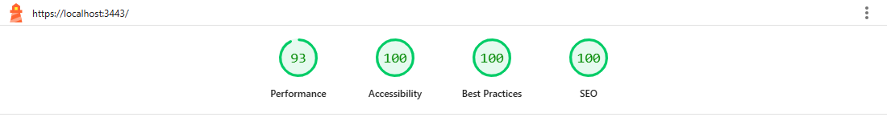
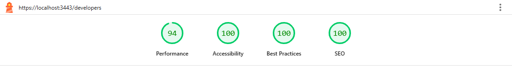
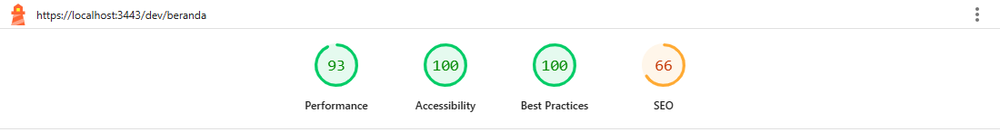
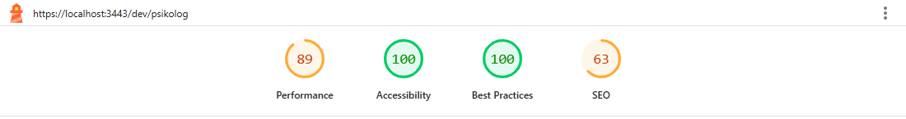
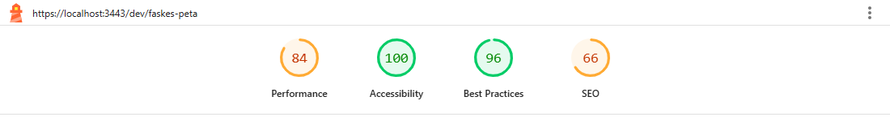
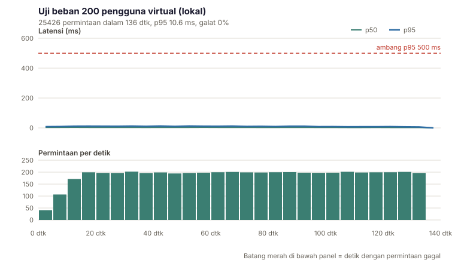

# Bukti pengujian

Semua angka di sini berasal dari proses yang bisa diulang di repositori ini, dengan perintahnya. Yang belum bisa diukur
(k6 asli, uji pengguna, uptime, alur berakun di situs live) ditulis terang-terangan di bagian [Yang belum terbukti](#yang-belum-terbukti).
Terakhir diperbarui 14 Oktober 2026.

| Bukti | Hasil | Cara mengulang |
| ----- | ----- | -------------- |
| Tes unit, komponen, dan basis data (Vitest) | **2250 lulus**, 116 berkas, 0 gagal (setelah `pnpm build`) | `pnpm build && pnpm test` |
| Tes e2e + aksesibilitas (Playwright, desktop 1440 dan mobile 390) | **614 lulus**, 68 dilewati (spec yang butuh akun sungguhan), 0 gagal, terhadap build produksi | `E2E_PORT=3200 pnpm test:e2e` (server produksi di port itu) |
| Audit aksesibilitas (axe, WCAG 2.2 AA) | 33 rute x 2 viewport, **0 pelanggaran**; ditambah keadaan yang berubah (dialog hapus akun dan persetujuan admin terbuka, napas berjalan dan selesai, grounding, lokasi aktif, daftar kosong dan gagal, panduan awal setelah galat) di `e2e/gelombang1.spec.ts` dan `e2e/gelombang3.spec.ts` | `e2e/fase5.spec.ts` |
| Lighthouse (12.8.2) | Aksesibilitas **100** di semua 48 pengukuran; halaman publik P 93-100, BP 100, SEO 100 | `pnpm lighthouse` |
| Lighthouse **di produksi** (Vercel, 14/15 Okt 2026) | 10 halaman publik x mobile dan desktop = 20 pengukuran: Performa 98-100, Aksesibilitas **100**, Praktik terbaik **100**, SEO **100** | `node scripts/lighthouse-audit.mjs --base https://web-omega-one-69.vercel.app --summary docs/lighthouse/produksi` |
| Pemeriksaan situs live (tanpa akun) | Halaman publik 200; `/api/health` ok (menyentuh Supabase); guard rute 307 ke `/masuk`; API tanpa token 401; `/dev/*` 404; header keamanan lengkap; sitemap dan robots memakai alamat produksi | bagian 3a |
| Uji beban lokal, 200 pengguna virtual | **25.426 permintaan, 0 galat, p95 10,6 ms** (bukan k6; lihat catatan) | `pnpm load` |
| Pembatas laju di bawah beban | Satu IP, 200 koneksi paralel, 600 permintaan: tepat **60 lolos, 540 ditolak 429** | `pnpm load --limiter-check` |
| Uji mutasi | Perusakan sengaja pada logika inti; semua tertangkap kecuali yang setara perilaku | lihat [DECISIONS.md](DECISIONS.md) |
| Pemeriksaan tipe, lint, format | bersih (TypeScript strict, ESLint `--max-warnings=0`, Prettier) | `pnpm typecheck && pnpm lint && pnpm format:check` |

## 1. Tes otomatis

- **Vitest** (2250 tes): logika domain murni (skoring skrining identik dengan aplikasi Flutter, deteksi krisis, FHIR,
  slot konsultasi, SUS), kerangka API, komponen, dan **aturan RLS di Postgres sungguhan** (PGlite dengan peran dan klaim JWT
  yang meniru Supabase). Tes penjaga hasil build memastikan rute yang memuat data per pengguna tidak ikut diprerender (data satu orang tak boleh
  masuk cache CDN) dan halaman marketing tetap statis; tes itu hanya aktif setelah `pnpm build`.
- **Playwright** (682 kasus = 341 per viewport): halaman publik, formulir, guard rute, 22 halaman pratinjau berisi komponen
  yang sama dengan halaman berlogin, perilaku HTTP API (401, 403, 422, 429, OpenAPI, FHIR), dan audit aksesibilitas.
  56 kasus dilewati karena membutuhkan akun uji sungguhan dan MENULIS data; cara menjalankannya ada di
  [PANDUAN-PENGEMBANG.md](PANDUAN-PENGEMBANG.md).
- **Uji mutasi.** Setiap fase merusak logika intinya dengan sengaja (migrasi SQL, urutan krisis-sebelum-model, batas laju,
  penyaring izin) lalu memastikan suite gagal. Pada Fase 5, 42 perusakan atas penilai SUS, pembaca CSV, laporan, `siteUrl`,
  dan `robots`/`sitemap`: 5 lolos pada putaran pertama. Empat adalah celah tes yang nyata (selang kepercayaan tak diuji
  di ujung 0 dan 100, nilai t untuk n besar, urutan prioritas butir, jawaban terbuka kosong) dan ditutup; satu setara
  perilaku (CRLF dihitung dua baris tak berpengaruh karena baris kosong memang dibuang). Penelusuran itu juga memperbaiki
  satu hal di kode: nilai t untuk df di atas 30 semula 1,96 (terlalu sempit), kini diambil dari tabel terdekat di bawahnya.
- **CI GitHub Actions** (akar repositori, `.github/workflows/ci.yml`, Ubuntu): job web (format, lint, tipe, build, Vitest), e2e
  (Playwright + axe terhadap build produksi), dan Flutter (`analyze`, `test`). Putaran kedua hijau seluruhnya
  ([https://github.com/Argy1/Mindra/actions/runs/38585195586](https://github.com/Argy1/Mindra/actions/runs/38585195586)); putaran pertama gagal di job Flutter karena folder aset kosong yang tidak dilacak git, ditemukan dan diperbaiki.
  CI tidak memakai rahasia sungguhan. Ukuran terhadap URL demo ada di bagian 3 (Lighthouse produksi) dan bagian 3a.
- **Gelombang 1** (profil, admin, naskah hukum, statistik wilayah opt-in): `tests/db/region-admin.test.ts` (33 tes basis data
  untuk migrasi `…000600`), 6 tes kesetaraan daftar slot database dengan kode TypeScript, 135 tes unit untuk validasi profil,
  peninjauan admin, ekspor data, dan dua Server Action, serta `e2e/gelombang1.spec.ts` (profil, antrean admin, penjaga rute,
  axe dengan dialog terbuka). **Uji mutasi Gelombang 1: 33 perusakan SQL dan 84 perusakan logika web.** Putaran pertama
  meloloskan 8 dan 9 secara berurutan; semuanya celah tes (ditutup) kecuali satu yang setara perilaku (G06, dilindungi
  trigger). Aplikasi Flutter: `flutter analyze` 0 galat dan 0 peringatan (115 info, sama seperti sebelum Gelombang 1),
  `flutter test` 160 lulus (137 setelah Gelombang 1, ditambah 23 tes Gelombang 2 untuk pembaca SSE dan layanan Teman cerita lewat
  web). `e2e/gelombang1.auth.spec.ts` (spec berakun) ditulis tetapi belum dijalankan.
- **Gelombang 3** (bantuan, layanan terdekat, panduan awal, ringkasan Teman cerita): domain napas dan grounding (tes batas fase
  tepat, pengumuman hanya di pergantian fase), 47 tes hitung jarak dan penyaringan layanan, tes komponen (jam palsu, lokasi
  palsu, keadaan galat), `tests/db/companion-activity.test.ts` (19, Postgres tiruan), dan `e2e/gelombang3.spec.ts` (jam
  Playwright dibekukan untuk batas fase, lokasi palsu dengan perekaman semua permintaan jaringan, `/bantuan` tanpa cookie dan
  penyimpanan, axe pada keadaan yang berubah). **139 perusakan sengaja**, semua tertangkap kecuali 2 yang setara perilaku. Satu
  temuan di luar cakupan (ketidakcocokan id hidrasi acak, sudah ada sebelumnya) dicatat di `TEMUAN-KEAMANAN.md`; Playwright
  dikonfigurasi satu ulangan lokal.
- **Pelajaran dari pengukuran yang tampak "lulus".** Tes aksesibilitas diberi kontrol negatif: elemen berkontras buruk dan
  tombol tanpa nama disuntikkan ke halaman, dan axe melaporkan `color-contrast` serta `button-name`. Artinya 0 pelanggaran
  di atas bukan karena audit yang tak bisa gagal.

## 2. Aksesibilitas (bobot 15%)

Target: WCAG 2.1 AA (CLAUDE.md). Diukur lebih ketat: **WCAG 2.2 AA + praktik terbaik axe**.

| Pemeriksaan | Cakupan | Hasil |
| ----------- | ------- | ----- |
| axe-core (tag `wcag2a`, `wcag2aa`, `wcag21a`, `wcag21aa`, `wcag22aa`, `best-practice`) | 11 rute publik/auth + 22 pratinjau berlogin (termasuk `/dev/profil`, `/dev/admin`, dan `/dev/layanan-terdekat`), desktop dan mobile | 0 pelanggaran |
| Jalan-jalan keyboard otomatis | Tab melewati setiap elemen yang bisa difokus di 33 rute x 2 viewport | Tidak ada jebakan keyboard, setiap fokus tampak punya cincin (outline atau bayangan), tidak ada `tabindex` positif, tidak ada elemen tak terlihat yang bisa difokus |
| Skip link, urutan Tab landing | Tab pertama = "Langsung ke konten"; urutan logo, menu, masuk, daftar, hero | lulus |
| `prefers-reduced-motion` | Diagram ekosistem: benang tergambar penuh, denyut disembunyikan, 0 animasi berulang | lulus |
| Kontras | Dihitung axe di setiap rute (teks normal 4,5:1, teks besar 3:1); tombol sage memakai sage-600 (4,76:1 dengan teks putih) bukan sage-500 dari desain (3,19:1) | lulus |
| Tidak ada overflow horizontal | Halaman marketing (termasuk `/bantuan`) dan 22 pratinjau, 390 px | lulus |

**Batas yang jujur.** Alat otomatis hanya menangkap sebagian masalah aksesibilitas. Yang **belum** dilakukan: uji dengan
pembaca layar sungguhan (NVDA, TalkBack, VoiceOver), perbesaran teks 200% di perangkat nyata, dan uji dengan pengguna
disabilitas. Itu langkah yang disarankan sebelum 29 Oktober bila ada waktu; hasilnya belum ada, jadi tidak diklaim.

## 3. Lighthouse

Lighthouse **12.8.2** (via `pnpm dlx`, bukan dependensi proyek; versi 13.5.0 gagal dimuat di Node 24 dengan
`SyntaxError` pada `lib/cdt/SDK.js`, jadi versinya dikunci). Build produksi (`next start`) di mesin lokal, dilayani lewat
proxy HTTPS lokal bertanda tangan sendiri agar perilaku `upgrade-insecure-requests` pada CSP sama seperti produksi,
throttling mobile bawaan Lighthouse (simulasi: RTT 150 ms, 1,6 Mbps, CPU 4x lebih lambat), Chrome 155 (headless). Halaman berlogin tidak bisa diaudit tanpa akun, jadi **diwakili
rute pratinjau `/dev/*`** yang memakai komponen yang sama dengan data contoh.

Target (CLAUDE.md): Performa >= 90, Aksesibilitas >= 95, Praktik terbaik >= 95, SEO >= 90.

P = Performa, A = Aksesibilitas, BP = Praktik terbaik.

| Rute | Mobile (P / A / BP / SEO) | Desktop (P / A / BP / SEO) | LCP mobile | TBT mobile |
| ---- | ------------------------- | -------------------------- | ---------: | ---------: |
| `/` | 93 / 100 / 100 / 100 | 99 / 100 / 100 / 100 | 2.9 dtk | 40 ms |
| `/tentang` | 98 / 100 / 100 / 100 | 100 / 100 / 100 / 100 | 2.3 dtk | 58 ms |
| `/kebijakan-privasi` | 96 / 100 / 100 / 100 | 100 / 100 / 100 / 100 | 2.7 dtk | 56 ms |
| `/developers` | 94 / 100 / 100 / 100 | 100 / 100 / 100 / 100 | 3.0 dtk | 34 ms |
| `/masuk` | 95 / 100 / 100 / 100 | 100 / 100 / 100 / 100 | 2.8 dtk | 11 ms |
| `/daftar` | 95 / 100 / 100 / 100 | 100 / 100 / 100 / 100 | 2.8 dtk | 59 ms |
| `/lupa-sandi` | 96 / 100 / 100 / 100 | 100 / 100 / 100 / 100 | 2.6 dtk | 22 ms |
| `/dev/beranda` | 93 / 100 / 100 / 66 | 100 / 100 / 100 / 66 | 3.1 dtk | 4 ms |
| `/dev/asesmen` | 95 / 100 / 100 / 63 | 100 / 100 / 100 / 63 | 2.8 dtk | 9 ms |
| `/dev/hasil` | 96 / 100 / 100 / 63 | 100 / 100 / 100 / 63 | 2.6 dtk | 20 ms |
| `/dev/jurnal` | 92 / 100 / 100 / 66 | 100 / 100 / 100 / 66 | 3.2 dtk | 68 ms |
| `/dev/teman-cerita` | 94 / 100 / 100 / 63 | 100 / 100 / 100 / 66 | 3.0 dtk | 40 ms |
| `/dev/konsultasi` | 94 / 100 / 100 / 63 | 100 / 100 / 100 / 66 | 2.9 dtk | 19 ms |
| `/dev/konsultasi-detail` | 95 / 100 / 100 / 63 | 100 / 100 / 100 / 66 | 2.9 dtk | 64 ms |
| `/dev/privasi` | 91 / 100 / 100 / 63 | 100 / 100 / 100 / 66 | 3.3 dtk | 35 ms |
| `/dev/psikolog` | 89 / 100 / 100 / 63 | 100 / 100 / 100 / 66 | 3.6 dtk | 109 ms |
| `/dev/klien` | 91 / 100 / 100 / 58 | 100 / 100 / 100 / 58 | 3.3 dtk | 74 ms |
| `/dev/jadwal` | 95 / 100 / 100 / 63 | 100 / 100 / 100 / 66 | 2.8 dtk | 38 ms |
| `/dev/pendamping` | 92 / 100 / 100 / 63 | 100 / 100 / 100 / 66 | 3.3 dtk | 61 ms |
| `/dev/pendamping-detail` | 95 / 100 / 100 / 63 | 100 / 100 / 100 / 66 | 2.8 dtk | 20 ms |
| `/dev/faskes` | 95 / 100 / 100 / 63 | 100 / 100 / 100 / 66 | 2.9 dtk | 35 ms |
| `/dev/faskes-peta` | 84 / 100 / 96 / 66 | 97 / 100 / 100 / 66 | 4.4 dtk | 57 ms |
| `/dev/faskes-laporan` | 95 / 100 / 100 / 63 | 100 / 100 / 100 / 66 | 2.8 dtk | 40 ms |
| `/dev/kunci-api` | 92 / 100 / 100 / 63 | 100 / 100 / 100 / 66 | 3.2 dtk | 61 ms |

Tangkapan layar laporan (skor, dari `docs/img/lighthouse/`):

| Landing, mobile | Landing, desktop |
| --------------- | ---------------- |
|  |  |

| Dokumentasi API, mobile | Pratinjau beranda, mobile |
| ----------------------- | ------------------------- |
|  |  |

| Pratinjau dasbor psikolog, mobile (P 89) | Pratinjau peta faskes, mobile (P 84) |
| ---------------------------------------- | ------------------------------------ |
|  |  |

Laporan lengkap (JSON + HTML, ±800 KB per halaman) tidak disimpan di repositori; ringkasan mesin ada di
[`lighthouse/summary.json`](lighthouse/summary.json) dan [`lighthouse/summary.md`](lighthouse/summary.md).

### Lighthouse di produksi

Diukur 14/15 Okt 2026 terhadap <https://web-omega-one-69.vercel.app> (Vercel, sertifikat sah, tanpa proxy), dari komputer
pengembang, Lighthouse 12.8.2 dengan throttling bawaan (simulasi). Hanya halaman publik; halaman berlogin tidak bisa diaudit
tanpa akun dan `/dev/*` mati di produksi, jadi keduanya tetap diwakili tabel lokal di atas. Ringkasan mesin:
[`lighthouse/produksi/summary.json`](lighthouse/produksi/summary.json) dan [`summary.md`](lighthouse/produksi/summary.md).

| Rute | Mobile (P / A / BP / SEO) | Desktop (P / A / BP / SEO) | LCP mobile | TBT mobile |
| ---- | ------------------------- | -------------------------- | ---------: | ---------: |
| `/` | 100 / 100 / 100 / 100 | 100 / 100 / 100 / 100 | 1.8 dtk | 27 ms |
| `/tentang` | 100 / 100 / 100 / 100 | 100 / 100 / 100 / 100 | 1.7 dtk | 50 ms |
| `/bantuan` | 99 / 100 / 100 / 100 | 100 / 100 / 100 / 100 | 2.0 dtk | 59 ms |
| `/layanan-terdekat` | 99 / 100 / 100 / 100 | 100 / 100 / 100 / 100 | 1.9 dtk | 49 ms |
| `/syarat-penggunaan` | 99 / 100 / 100 / 100 | 100 / 100 / 100 / 100 | 1.8 dtk | 70 ms |
| `/kebijakan-privasi` | 100 / 100 / 100 / 100 | 100 / 100 / 100 / 100 | 1.8 dtk | 47 ms |
| `/developers` | 99 / 100 / 100 / 100 | 100 / 100 / 100 / 100 | 2.1 dtk | 85 ms |
| `/masuk` | 99 / 100 / 100 / 100 | 100 / 100 / 100 / 100 | 2.0 dtk | 49 ms |
| `/daftar` | 99 / 100 / 100 / 100 | 100 / 100 / 100 / 100 | 2.0 dtk | 70 ms |
| `/lupa-sandi` | 98 / 100 / 100 / 100 | 100 / 100 / 100 / 100 | 2.0 dtk | 120 ms |

Semua 20 pengukuran memenuhi target CLAUDE.md (P >= 90, A >= 95, BP >= 95, SEO >= 90); CLS paling tinggi 0,016 (`/developers`
desktop). Angkanya lebih tinggi daripada hasil lokal karena CDN Vercel melayani halaman statis. Batas: satu komputer dan satu
jaringan, nilai bisa berfluktuasi beberapa poin antar-putaran.

### Yang di bawah target dan alasannya

| Temuan | Alasan | Tindakan |
| ------ | ------ | -------- |
| **SEO 58-66 pada semua halaman `/dev/*`** | Satu pemeriksaan: `is-crawlable` gagal. Pratinjau memang `noindex` dan ditutup di `robots.txt` (disengaja; `/dev/klien` juga tak punya meta description). Halaman publik semuanya **SEO 100**. | Tidak ada. Portal asli juga tidak boleh diindeks. |
| **P 84 pada `/dev/faskes-peta` (mobile)** | LCP 4,4 dtk: ubin peta dari server OpenStreetMap (pihak ketiga) menjadi elemen terbesar. `BP 96` karena gambar ubin Leaflet tak berukuran responsif. | Diterima; peta memerlukan ubin. Pilihan lanjutan: peta statis lebih dulu, interaktif sesudah klik. |
| **P 89 pada `/dev/psikolog` (mobile)** | Bundel 243 kB (klien Realtime Supabase untuk peringatan krisis) pada throttling mobile. Desktop 100. | Dicatat. Memecah klien Realtime keluar dari bundel awal adalah perbaikan berikutnya. |
| P 91-94 pada beberapa pratinjau dan `/` mobile | Berfluktuasi antar-putaran (landing mobile terukur 93 sampai 97 pada putaran berbeda); LCP 2,3-3,0 dtk di bawah throttling mobile. | Tidak ada. |

### Dua temuan sepanjang pengukuran (diperbaiki atau dijelaskan)

1. **Pelanggaran CSP oleh Zod (diperbaiki).** Zod 4 mencoba `Function("")` untuk mengompilasi pemeriksa. CSP kita sengaja
   tanpa `unsafe-eval`, jadi browser mencatat `securitypolicyviolation` (galat tertangkap, aplikasi tetap jalan) dan
   Lighthouse menurunkan Praktik terbaik ke 96 di halaman berformulir. Diatasi `z.config({ jitless: true })` di
   `instrumentation-client.ts`, yang berjalan di browser sebelum skema dibuat. Dibuktikan dengan tes
   (`e2e/fase5.spec.ts`, bagian CSP) dan skor BP 100.
2. **Build produksi lewat HTTP biasa memberi galat konsol palsu (dijelaskan).** Di pratinjau, tautan navigasi ke halaman
   berlogin dialihkan ke `/masuk`; `upgrade-insecure-requests` menaikkan pengalihan itu ke `https://localhost`, yang gagal. Ini
   hanya muncul bila build produksi dibuka lewat HTTP. Lewat HTTPS galat itu hilang (diukur ulang di atas), jadi
   angka di tabel adalah angka lewat proxy HTTPS. Sudah diukur ulang terhadap produksi (bagian "Lighthouse di produksi"):
   di HTTPS Vercel galat itu tidak muncul. Perintah: `node scripts/lighthouse-audit.mjs --base https://web-omega-one-69.vercel.app --summary docs/lighthouse/produksi`
   (di Windows jalankan lewat PowerShell dan beri `--out` folder sederhana bila `--out` bawaan bermasalah di Bash).

## 3a. Pemeriksaan situs live (tanpa akun)

Dilakukan 14 Okt 2026 malam dan diulang 15 Okt 2026 dini hari setelah perbaikan alamat situs, terhadap
<https://web-omega-one-69.vercel.app>. Hanya permintaan baca tanpa kredensial; tidak ada data yang ditulis dan tidak ada
kata sandi atau kunci yang dimasukkan. Alatnya `curl` terhadap daftar rute di bawah.

| Pemeriksaan | Hasil |
| ----------- | ----- |
| Halaman publik (`/`, `/tentang`, `/bantuan`, `/layanan-terdekat`, `/syarat-penggunaan`, `/kebijakan-privasi`, `/developers`, `/masuk`, `/daftar`, `/lupa-sandi`) | 200 semuanya |
| `/robots.txt`, `/sitemap.xml`, `/api/v1/instruments`, `/api/v1/openapi.json` | 200 |
| `/api/health` | `{"data":{"status":"ok",...},"error":null}` (kueri `head` ke database: **koneksi Supabase berfungsi**) |
| `/layanan-terdekat` | Memuat 20 faskes dari tabel `facilities` (pembacaan publik lewat RLS) dan menyatakan "Daftar ini masih contoh" |
| Rute berlogin (11 rute) | 307 ke `/masuk?next=...` |
| `/dev/ui` | 404 (pratinjau mati di produksi) |
| `POST /api/v1/assessments` dan `POST /api/v1/companion/chat` tanpa token | 401 |
| Header di `/` | CSP (tanpa `unsafe-eval`), HSTS 2 tahun + includeSubDomains, `X-Frame-Options: DENY`, `X-Content-Type-Options: nosniff`, `Referrer-Policy`, `Permissions-Policy` |
| `sitemap.xml` dan `robots.txt` | **Awalnya mengarah ke `http://localhost:3000`** (`NEXT_PUBLIC_SITE_URL` belum diisi di Vercel). Diperbaiki di commit `0bc57bd` dengan cadangan `VERCEL_PROJECT_PRODUCTION_URL`; setelah deploy: 7 alamat berawalan `https://web-omega-one-69.vercel.app`, 0 `localhost` |

**Yang tidak diperiksa dan tidak boleh diklaim:** daftar dan masuk dengan akun nyata, email konfirmasi dan atur ulang sandi,
Teman cerita dengan model asli, MFA TOTP, portal psikolog, faskes, dan admin. Itu butuh akun atau rahasia yang hanya
pemilik pegang (lihat [`HANDOFF-FASE-6.md`](HANDOFF-FASE-6.md) bagian 15).

## 3b. Verifikasi migrasi `…000700` di cloud

Dilakukan 15 Okt 2026 setelah pemilik menempelkan berkasnya di SQL Editor. Semua perintah di bawah dijalankan terhadap proyek
cloud; pengujian perilaku memakai satu blok yang diakhiri `raise exception`, sehingga **seluruh data uji dan perubahan izin
dibatalkan otomatis** (diperiksa sesudahnya: 0 baris percakapan uji, izin `ai_summary` kembali `false`).

| Pemeriksaan | Hasil |
| ----------- | ----- |
| Katalog | `client_companion_activity(p_client uuid, p_days integer)` ada: `security definer`, `stable`, `search_path=""`, plpgsql |
| Hak akses | Hanya `authenticated`, `service_role`, dan pemilik (`postgres`); tidak ada `anon` atau `public` |
| Kolom yang dirujuk | `ai_conversations.user_id`, `messages` (jsonb), `crisis_detected`, `updated_at` ada dengan tipe yang diharapkan |
| Pemilik (aal1), 30 hari | 3 percakapan, 5 pesan, 3 hari aktif, 1 percakapan krisis (percakapan 200 hari lalu dan pesan bukan-array dihitung benar) |
| Jepit rentang | 365 hari = 4 percakapan; 99999 dijepit ke 365 (sama); -5 dijepit ke 1; `null` memakai 30 |
| Psikolog aal2 dengan izin `ai_summary` mati (keadaan nyata sekarang) | Ditolak 42501 |
| Psikolog aal2 dengan izin menyala | Berhasil, angka sama dengan pemilik |
| Psikolog aal1 dengan izin menyala | Ditolak 42501 (sakelar demo `app.psychologist_mfa` tidak diatur di cloud, jadi MFA berlaku) |
| Pendamping aal2 | Ditolak 42501 |
| `p_client` null; psikolog ke akun tanpa tautan | Ditolak 42501 |
| `anon` | `permission denied for function` (42501) |
| Psikolog aal2 membaca `ai_conversations` langsung | **0 baris** (isi percakapan tidak bisa dibaca lewat jalur lain) |

Data sungguhan tidak tersentuh: baris uji dibuat dan dibatalkan dalam transaksi yang sama.

## 4. Uji beban

**Skrip k6: [`load/read-endpoints.js`](../load/read-endpoints.js)**, 200 VU, naik 15 dtk, bertahan 2 menit, ambang p95 < 500 ms
dan galat < 1% (keseluruhan dan per endpoint). **Skrip itu belum dijalankan**: k6 adalah biner terpisah yang tidak terpasang
di mesin ini dan pemasangan di mesin pemilik proyek tidak saya lakukan sendiri.

Sebagai gantinya ada **padanan tanpa dependensi, [`load/node-load.mjs`](../load/node-load.mjs)** dengan profil, bobot endpoint,
jeda, dan ambang yang sama. **Itu bukan k6**; angkanya tidak boleh ditulis sebagai hasil k6.

### Hasil: lokal, build produksi, 200 pengguna virtual

Mesin: Intel(R) Core(TM) Ultra 7 255HX (20 inti, 31,4 GB), win32 10.0.26300, Node v24.13.1. **Server dan penguji
beban berjalan di mesin yang sama dan berbagi CPU**; tidak ada jaringan di antaranya. Yang diukur adalah kapasitas aplikasi
(halaman statis dan endpoint ringan), bukan latensi yang dialami pengguna di internet.

| Ukuran | Hasil |
| ------ | ----- |
| Profil | naik 15 dtk, bertahan 120 dtk, 200 VU, jeda 0,5-1,5 dtk, IP acak per permintaan |
| Permintaan | 25426 (186,3/dtk) |
| Galat | 0 (0%), semua status 200 |
| Latensi | rata-rata 4,3 ms, median 3,4 ms, p90 8,3 ms, **p95 10,6 ms**, p99 16,2 ms, maks 37 ms |
| Ambang | p95 < 500 ms: **lulus** · galat < 1%: **lulus** (keseluruhan dan kelima endpoint) |

| Endpoint | Permintaan | Median | p95 | p99 | Maks | Galat |
| -------- | ---------: | -----: | --: | --: | ---: | ----: |
| `/` | 8546 | 4 ms | 11,6 ms | 17,3 ms | 37 ms | 0% |
| `/developers` | 2741 | 6,7 ms | 15,1 ms | 23,1 ms | 33 ms | 0% |
| `/tentang` | 1403 | 3,4 ms | 11,7 ms | 17 ms | 24,7 ms | 0% |
| `/api/v1/instruments` | 9797 | 1,6 ms | 5,9 ms | 9,4 ms | 20,4 ms | 0% |
| `/api/v1/openapi.json` | 2939 | 3,9 ms | 8,4 ms | 11,8 ms | 20,5 ms | 0% |



Dua putaran berturut-turut memberi hasil yang sama (25.4 ribu permintaan, p95 sekitar 11 ms), jadi angka ini stabil.
Data mentah: [`load/results/lokal.json`](../load/results/lokal.json).

**Yang dibuktikan:** aplikasi tidak mengalami galat atau degradasi di 200 pengguna konkuren pada endpoint baca publik di
mesin ini. **Yang tidak dibuktikan:** performa di Vercel, di bawah latensi jaringan nyata, atau pada endpoint yang membaca
database (`/api/health` dan endpoint berotorisasi sengaja tidak ditembak agar proyek Supabase cloud bersama tidak
terbebani). Untuk itu jalankan k6 terhadap URL demo (lihat di bawah); di Vercel header `x-real-ip` ditimpa platform sehingga
satu mesin penguji akan terkena batas 60 permintaan/menit/IP dan angka galatnya tidak mewakili kapasitas.

### Pembatas laju di bawah beban

Satu IP, 200 koneksi paralel, 600 permintaan ke `/api/v1/instruments`: **60 diterima, 540 ditolak 429**,
tepat sesuai batas publik 60 permintaan per menit per IP. Pembatas tidak bocor di bawah konkurensi.

### Menjalankan k6 sendiri (belum dilakukan)

```bash
# Windows: winget install k6 --source winget   (atau unduh dari https://k6.io)
pnpm build && pnpm start --port 3200            # target lokal
k6 run -e BASE_URL=http://localhost:3200 -e SPOOF_IP=1 load/read-endpoints.js --summary-export=load/results/k6-summary.json

# Terhadap demo online (tanpa SPOOF_IP; ingat batas 60 permintaan/menit/IP akan menjawab 429 dari satu mesin):
k6 run -e BASE_URL=https://<url-demo> -e VUS=20 load/read-endpoints.js
```

Setelah dijalankan: lampirkan `p(95)` dan `http_req_failed` dari ringkasan k6 di sini, dan tandai bahwa itu hasil k6.

## 5. Uptime

- **Titik pemeriksaan:** `GET /api/health` menyentuh database (kueri `head` tanpa membaca data, kunci anon) dan menjawab
  `200 {"data":{"status":"ok"}}` atau 503. Sekaligus menjaga proyek Supabase free tier tidak "tertidur" (dijeda otomatis bila
  tak aktif sekitar 7 hari) selama masa penilaian 31 Okt-27 Nov.
- **GitHub Actions:** [`.github/workflows/uptime.yml`](../.github/workflows/uptime.yml) memeriksa tiap 15 menit dan gagal
  (email ke pemilik repo) bila tidak sehat setelah 3 percobaan. Perlu variabel repositori `DEMO_URL`. Jadwal Actions
  best-effort dan dimatikan GitHub setelah 60 hari tanpa aktivitas, jadi ini pelengkap.
- **Monitor eksternal (belum terpasang, butuh URL demo):** UptimeRobot gratis, jenis "Keyword", URL `https://<url-demo>/api/health`,
  kata kunci `"status":"ok"`, interval 5 menit, beri notifikasi email. Setelah aktif beberapa hari, tangkap layar halaman
  statusnya ke `docs/img/uptime.png` untuk proposal.
- **Status: belum aktif.** Aplikasi sudah dideploy (<https://web-omega-one-69.vercel.app>) tetapi monitor eksternal belum dipasang
  dan variabel repositori `DEMO_URL` belum diisi; tidak ada angka uptime untuk dilaporkan.

## 6. Uji pengguna (SUS)

Protokol, persetujuan, tugas, kuesioner SUS, dan alat rekap sudah siap: [UJI-PENGGUNA.md](UJI-PENGGUNA.md), `pnpm usability:report`.
**Belum ada responden dan belum ada skor.** Jadwalnya 24-26 Oktober; skor SUS di proposal hanya boleh dari sesi nyata.

## Yang belum terbukti

| Klaim yang bisa muncul di proposal | Status | Yang dibutuhkan |
| ---------------------------------- | ------ | --------------- |
| Aplikasi berjalan online | **Terbukti tanpa akun** (bagian 3a). Alur berakun belum | Tambahkan URL ke Site URL dan Redirect URLs Supabase, SMTP, lalu coba daftar dan masuk di peramban |
| Hasil k6 | Skrip siap, belum dijalankan | Pasang k6, jalankan terhadap lokal dan demo |
| Performa di produksi (beban) | Lighthouse produksi **sudah** (bagian 3); beban belum (hanya lokal) | Ulangi `pnpm lighthouse --base https://<url-demo> --insecure` hanya bila sertifikatnya swatandatangani; untuk URL Vercel cukup `--base` setelah deploy |
| Uptime | Belum terpasang | URL demo + UptimeRobot |
| SUS | Belum ada responden | Sesi uji 24-26 Okt |
| Teman cerita dengan model sungguhan | Belum pernah dijalankan dengan kunci Anthropic asli | Isi `ANTHROPIC_API_KEY` di lingkungan demo, coba beberapa percakapan (termasuk jalur krisis) |
| Pengiriman ke SATUSEHAT | Hanya mode simulasi lokal | Kredensial staging Kemenkes dan nomor IHS pasien |
| Alur dengan akun sungguhan (`*.auth.spec.ts`) | 56 kasus dilewati; alur Gelombang 1 (profil dan admin dengan akun nyata) belum punya spec berakun | Akun uji + variabel `E2E_*` (petunjuk di PANDUAN-PENGEMBANG) |
| Migrasi `…000600` di proyek cloud | **Sudah diterapkan dan diverifikasi** (14 Okt 2026); akun admin dan calon psikolog ditambahkan lewat `pnpm seed --yes --add-accounts` | - |
| Fungsi baru dari aplikasi Flutter di perangkat | Teruji pemetaan, logika, dan analisis statis; belum dijalankan di perangkat atau emulator | Bangun ulang aplikasi setelah migrasi diterapkan, coba pesan konsultasi, ubah profil, hapus akun |
| Migrasi `…000700` di proyek cloud | **Sudah diterapkan dan diverifikasi** (15 Okt 2026), lihat bagian 3b | - |
| Latihan napas dan grounding dengan pembaca layar sungguhan | Belum (struktur, wilayah live, dan axe terbukti) | NVDA, TalkBack, VoiceOver |
| Lighthouse untuk `/profil` dan `/admin/*` | `/syarat-penggunaan`, `/bantuan`, `/layanan-terdekat` sudah diukur di produksi; halaman berlogin belum | Lewat pratinjau lokal `/dev/profil` dan `/dev/admin` (`pnpm lighthouse`) |
| Login admin faskes memakai TOTP asli | Hanya diuji di database dan komponen | Pasang TOTP di aplikasi autentikator sungguhan sekali |
| Uji pembaca layar | Belum | NVDA/TalkBack/VoiceOver |
